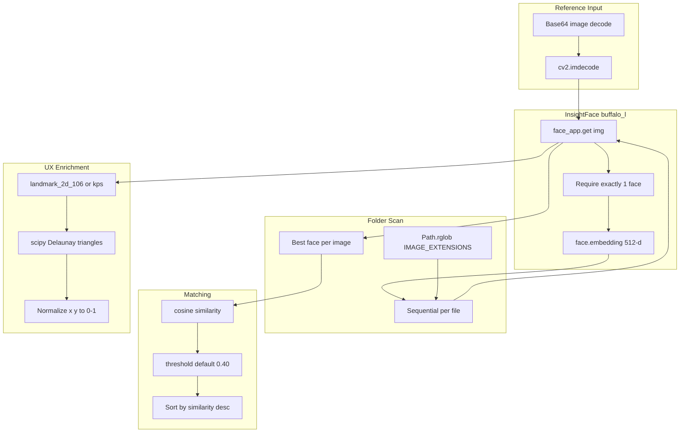
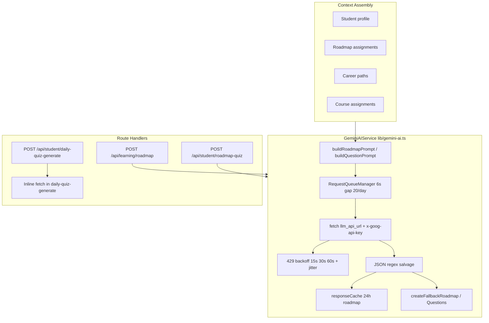
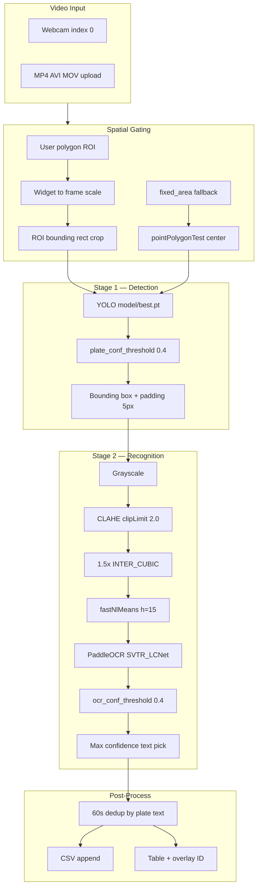
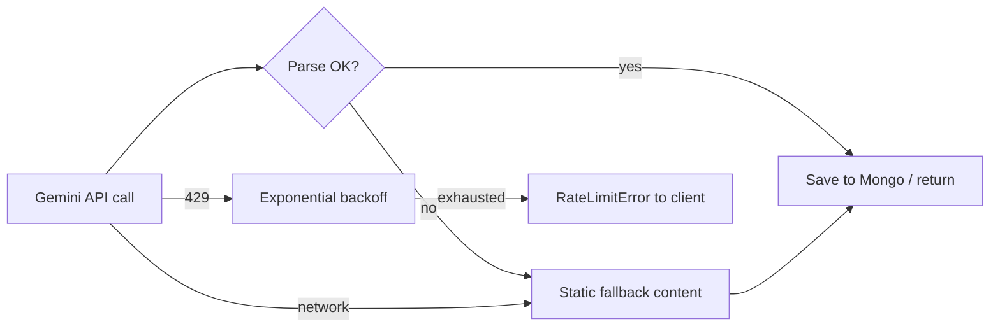
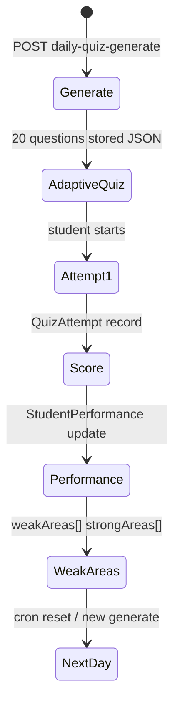

# AI Engineering

**Related:** [[Software Architecture]] · [[Performance]] · [[Problem Solving]] · [[Backend Engineering]]

---

## Six AI Systems in One Engineer

| Dimension | Face Finder | NexusPath | Iink | MAPIMS | VocalAng | KVCET ANPR |
|-----------|-------------|-----------|------|--------|----------|------------|
| Primary modality | Face recognition (embeddings) | Text generation (structured JSON) | Vision-language (page images) | Text + speech (Tamil/English) | Real-time voice (English) | Real-time video (license plates) |
| Model host | Local InsightFace ONNX | Google Gemini API (cloud) | Local GPU / vLLM / Chandra GGUF | OpenRouter API | Local Ollama + faster-whisper | Local YOLO CUDA + PaddleOCR CPU |
| Output | Similarity score + bbox + mesh | Roadmaps, quizzes, resources | Layout JSON / markdown | Sentiment, urgency, issues[] | Spoken TTS + interview report | Plate text + dual confidence scores |
| Personalization | Cosine threshold slider | Roadmap assignments, career path, dept, year | Project settings | Patient context, dept routing | Interview Q1–Q10 script | ROI polygon + threshold tuning |
| Evaluation | Operator threshold tuning | Quiz scores, performance categories | Human Neural Review | HOD queue + admin analytics | Rule scores + LLM report | Operator-visible conf bars; CSV audit |
| Vector/RAG | **Cosine on 512-d embeddings** | None | None | None | Face embeddings only | None |

---

## Face Finder Computer Vision Pipeline



**Architecture choice:** **Embedding-based 1:N face search** — no vector database; brute-force cosine compare against every detected face in every image. Correct for local folders (<10k images); would need FAISS/Milvus at scale.

---

## Model Selection — Face Finder

| Component | Model | Config | Why chosen |
|-----------|-------|--------|------------|
| Detection + embedding | InsightFace `buffalo_l` | ArcFace 512-d, `det_size=(640,640)` | Industry-standard accuracy/speed balance; single model does detect + embed |
| Runtime | ONNX Runtime | CUDA preferred, CPU fallback | Same stack as VocalAng face module; pip NVIDIA libs |
| Similarity | Cosine on raw embeddings | Threshold 0.40 default | InsightFace embeddings are L2-normalized in practice; explicit norm guard |
| Landmarks | 106-point 2D or 5 kps | Delaunay triangulation | Rich scan UX without second model |
| Multi-face images | Best match above threshold | Not all faces returned | User wants "photos of me" not "every face in crowd shot" |

**Env toggles:**
- `FACE_FINDER_FORCE_CPU=1` — disable CUDA provider selection
- `PORT` — default 5002
- `LD_LIBRARY_PATH` — patched at startup from pip nvidia packages

**CUDA bootstrap (engineer signature):**
```python
# _preload_cuda_libs() — before insightface import
ctypes.CDLL(libcudnn.so.9, mode=RTLD_GLOBAL)
# + cublas, cudart; append nvidia/*/lib to LD_LIBRARY_PATH
```
This solves the common **"CUDA requested but CPU active"** ONNX Runtime failure when cuDNN isn't on system path but is pip-installed.

---

## Face Finder — No LLM, No RAG

Face Finder is **pure classical deep CV** — no prompts, no agents, no retrieval:

| Technique | Present | Notes |
|-----------|---------|-------|
| Embeddings | ✅ ArcFace 512-d | Computed per face detection |
| Vector index | ❌ | Linear scan O(n×faces) |
| Fine-tuning | ❌ | Off-the-shelf buffalo_l |
| Threshold calibration | ✅ User slider 0.25–0.75 | Product-level "evaluation" |
| Multi-face rejection | ✅ Reference must be solo | Reduces false descriptor noise |

**Why InsightFace over cloud APIs (AWS Rekognition, Azure Face):**
- Privacy — photos never leave machine
- Cost — no per-image API fees for 10k folder scans
- Latency — no network round-trip per image
- VocalAng reuse — same stack already proven in interview project

---

## NexusPath Gemini Pipeline



**No RAG, no embeddings, no agent loop** — single-shot structured generation with context injected via prompt templates.

---

## KVCET ANPR Computer Vision Pipeline



**Architecture choice:** Classic **detect-then-read ANPR** — YOLO localizes plate; PaddleOCR reads crop only.

---

## Model Selection — KVCET ANPR

| Stage | Model | Config | Why chosen |
|-------|-------|--------|------------|
| Detection | Ultralytics YOLO (`best.pt`) | Custom fine-tuned | Domain plates at campus gate angle |
| Recognition | PaddleOCR | `SVTR_LCNet`, `lang=en`, `use_angle_cls=True` | Strong Latin OCR on CPU |
| Preprocessing | OpenCV classical | CLAHE + denoise + 1.5× upscale | Glare handling without retrain |
| Runtime | PyTorch + PaddlePaddle | YOLO CUDA; OCR CPU | VRAM split on gate workstation |

**Env:** `PADDLE_DISABLE_ONEDNN=1` before import — OneDNN Windows compatibility.

---

## Model Selection — NexusPath

| Function | Model | Why |
|----------|-------|-----|
| Roadmap generation | Gemini (env `llm_model`, default flash) | Structured JSON output; faculty-facing content quality |
| Daily quiz (20 Q) | Gemini 2.0 flash via inline fetch | Personalized from roadmap skill extraction |
| Roadmap quiz | `GeminiAIService.generateQuestionsWithGemini` | Centralized queue + retry |
| Learning resources | `generateLearningResources` | Curated URL lists in JSON |
| Code test questions | `/api/code-execution/generate-questions` | Separate prompt for Judge0-compatible problems |
| AI suggestions | **Rule-based** (not LLM) | `generatePersonalizedSuggestions()` — academic year heuristics |

**Critical design:** Free tier awareness — `RequestQueueManager` enforces 6-second minimum between requests and 20/day cap with `QuotaExceededError`.

---

## Prompt Engineering — NexusPath

| Technique | Implementation | Why |
|-----------|----------------|-----|
| JSON-only output contract | `"RESPONSE FORMAT (valid JSON only, no extra text)"` | Parseable without tool calling |
| JSON salvage | `text.match(/\{[\s\S]*\}/)` or `\[[\s\S]*\]` | LLM adds markdown fences despite instructions |
| Markdown fence strip | `.replace(/^```json\s*/i, '')` in daily-quiz | Second salvage layer |
| Context injection | Student dept, year, career paths, roadmap skills | Personalization without fine-tuning |
| Skill keyword extraction | `extractSkillsFromText()` regex list | Bridge structured DB → prompt context |
| Difficulty distribution | `30% EASY, 50% MEDIUM, 20% HARD` | Controlled assessment spread |
| Token budget | `maxOutputTokens: 4096→3000→2000` per method | Free tier cost control |
| Temperature tuning | 0.5 roadmaps (consistent), 0.7 quizzes (variety) | Task-appropriate creativity |
| Compact prompts | Milestone count 6-8 not 8-12 | Reduce truncation failures |

**Roadmap prompt structure:**
```
STUDENT PROFILE → REQUIREMENTS → RESPONSE FORMAT (JSON schema example)
```

**Quiz prompt structure:**
```
STUDENT PROFILE → QUIZ REQUIREMENTS → GENERAL/CODING FOCUS blocks → JSON array example
```

---

## Fail-Forward AI — NexusPath



| Failure mode | Handler | User experience |
|--------------|---------|-----------------|
| JSON parse fail | `createFallbackRoadmap()` | Generic 2-milestone roadmap |
| Empty candidates | throw → catch → fallback | Never blank quiz |
| 429 rate limit | 3 retries with jitter | Transparent retry or error message |
| Daily quota | `QuotaExceededError` | Frontend shows reset time via `useAIGeneration` |
| Missing API key | throw at service init | 500 with config error |

**Philosophy:** LMS must function when AI degrades — fallback questions still test general CS knowledge.

---

## Adaptive Assessment — NexusPath



**Data model linkage:**
- `AdaptiveQuiz.questions` — JSON string from Gemini
- `QuizAttempt` — answers, score, wrongAnswers feedback JSON
- `StudentPerformance` — per-category knowledgeLevel 1-5, weakAreas/strongAreas arrays
- `QuizSession` — aggregate session metrics

**Personalization path:** `extractRoadmapInfo()` walks `roadmapAssignments → courseAssignments → assignments` to build skill set for prompt — **context from institutional data, not user chat history**.

---

## Dual AI Integration Paths — NexusPath (Debt Signal)

| Path | Location | Features |
|------|----------|----------|
| **Centralized** | `lib/gemini-ai.ts` | Queue, cache, custom errors, fallbacks |
| **Inline** | `daily-quiz-generate/route.ts` | Direct fetch, own parse/fallback, `new PrismaClient()` |

**Why both exist:** Route built before service extraction; inline path uses `?key=` query param vs `x-goog-api-key` header — **inconsistent API client patterns**.

**Engineer intent:** Extract when pain appears (429 limits forced `GeminiAIService` creation); not all routes migrated yet.

---

## MAPIMS AI Pipeline (Retained)

OpenRouter structured extraction → split tickets → deferred worker.

**Key files:** `openRouterAnalysis.js`, `openRouterPrompts.js`, `pendingAiWorker.js`

---

## VocalAng Real-Time Voice Pipeline (Retained)

FastRTC → Silero VAD → Whisper → Ollama → Kokoro TTS. Rule-first validation on interview path.

See prior vault sections for full VocalAng/Iink detail.

---

## Code Execution AI — NexusPath

Judge0 integration is **not LLM inference** but **external code sandbox**:

| Step | API | Pattern |
|------|-----|---------|
| Submit | POST `/submissions?wait=false` | Returns token immediately |
| Poll | GET `/submissions/{token}` | Client polls until status complete |
| Encode | base64 source_code + stdin | Judge0 API requirement |
| Limits | cpu_time_limit 2s, memory 128MB | Sandbox safety |

Question generation for code tests uses Gemini separately (`/api/code-execution/generate-questions`).

---

## Evaluation Strategy — All Projects

| Project | Method | Gap |
|---------|--------|-----|
| Face Finder | Threshold slider; visual mesh confirmation | No FAR/FRR benchmark; no LFW eval |
| NexusPath | Quiz scores, code test results, analytics dashboards | No prompt regression; no LLM output quality metrics |
| Iink | Processing CSV, human Neural Review | No CER/layout IoU |
| MAPIMS | Admin analytics, ticket queue | No prompt regression |
| VocalAng | Rule scores, manual testing | No WER/CER on STT |
| KVCET ANPR | Dual confidence bars; operator CSV review | No mAP/CER benchmark; no held-out test set |

**Maturity pattern:** Operational testing + human review > automated ML metrics.

---

## Why These Approaches — NexusPath

| Decision | Reason |
|----------|--------|
| Cloud Gemini vs local | No GPU ops burden; faculty generates content on demand |
| JSON in Mongo strings | Prompt schema evolves faster than Prisma migrations |
| Request queue | Hit free tier 429 immediately without throttling |
| In-memory roadmap cache | Same faculty regenerates identical roadmap params |
| Rule-based suggestions endpoint | Avoid LLM cost for simple "next course" recommendations |
| Fallback content | Students must take quiz even if Gemini down |
| Separate aiApi 120s timeout | Roadmap generation exceeds default 30s |

---

## Why These Approaches — Face Finder

| Decision | Reason |
|----------|--------|
| buffalo_l not buffalo_s | Higher accuracy for reference matching; VRAM acceptable for single model |
| Cosine not Euclidean | Standard metric for normalized face embeddings |
| Sequential scan not parallel | Simplicity; GIL limits Python threading; GPU batching needs refactor |
| SSE not WebSocket | One-way server→client progress; simpler Flask `Response(stream_with_context)` |
| Mesh in SSE payload | Frontend FaceMesh SVG without second API call |
| 640×640 det_size | InsightFace default tradeoff for detect recall |
| Reject multi-face reference | Ambiguous identity — forces user to pick clear selfie |

---

## Not Present (Any Project)

- Fine-tuning / LoRA (KVCET uses pre-trained `best.pt` — training pipeline not in repo)
- RAG + vector retrieval (Face Finder has embeddings but **no ANN index**)
- Multi-agent tool orchestration
- Automated A/B prompt testing
- Model observability (LangSmith, etc.)
- LLM integration (KVCET ANPR)

**Present in KVCET only:** Classical CV preprocessing + custom YOLO + PaddleOCR two-stage pipeline — **traditional ML/CV** not generative AI.

See [[Learning Roadmap]].
