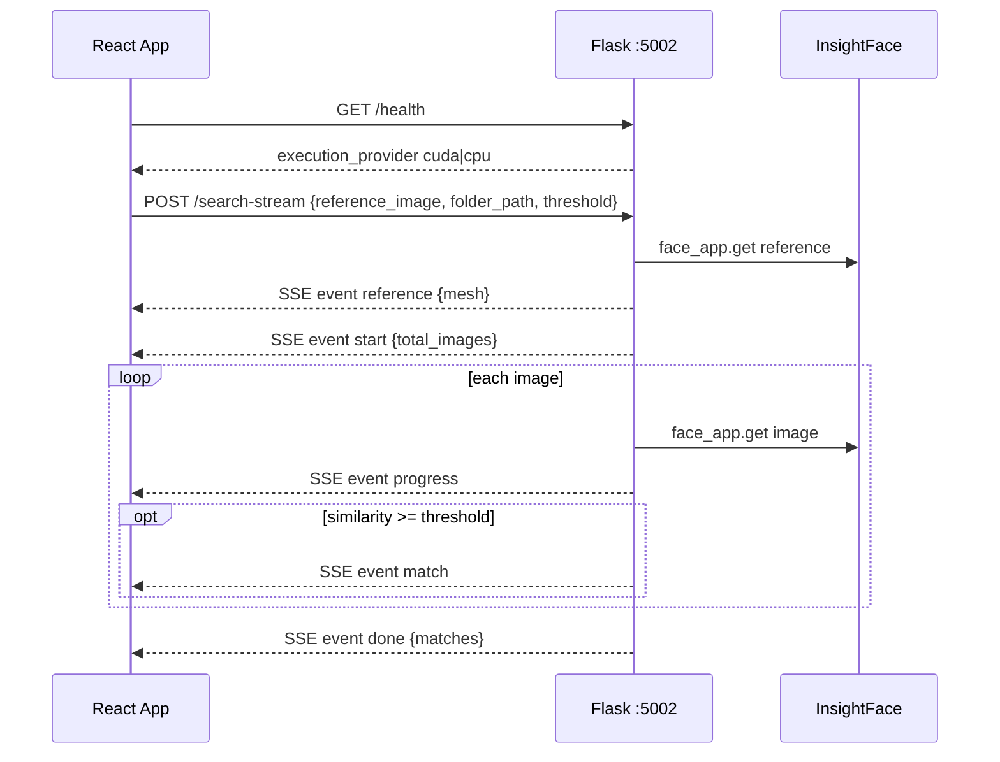
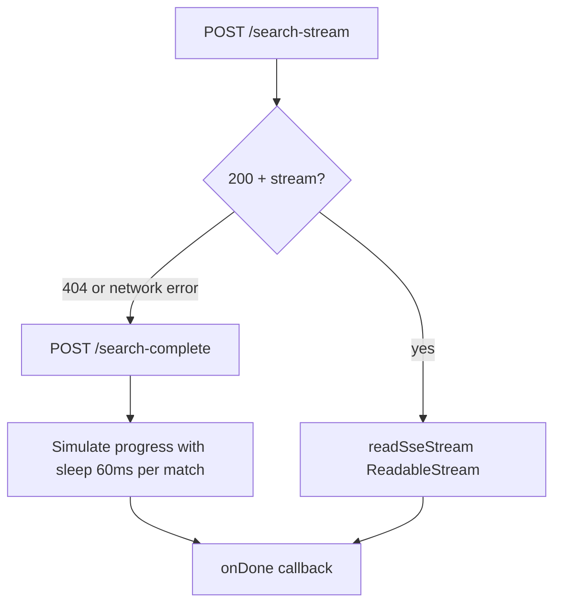
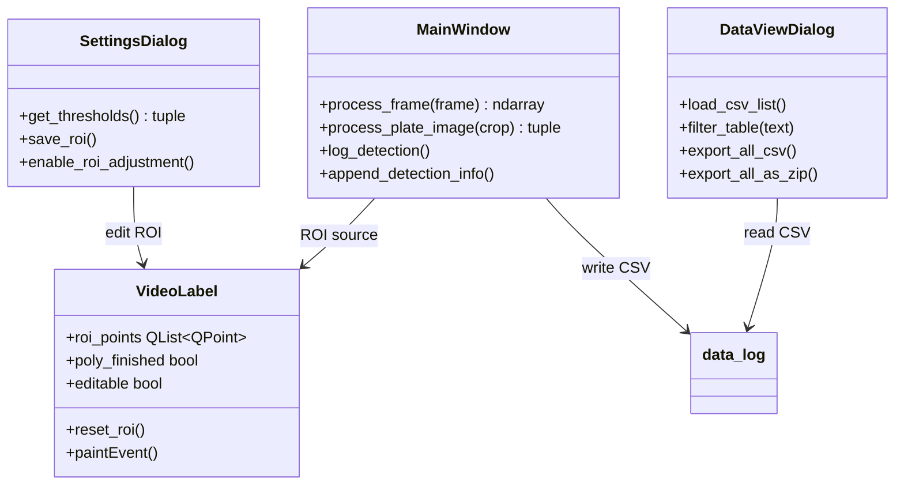
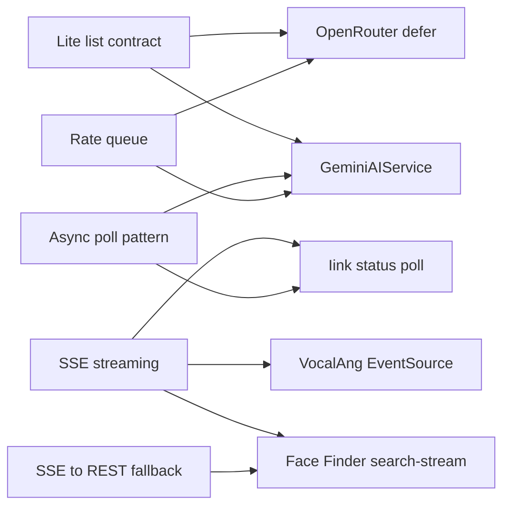

# API Design

**Related:** [[Backend Engineering]] · [[Security]] · [[Software Architecture]] · [[Performance]]

---

## API Styles — All Projects

| Style | Face Finder | NexusPath | Iink | MAPIMS | VocalAng | KVCET ANPR |
|-------|-------------|-----------|------|--------|----------|------------|
| Primary | REST JSON + SSE | REST JSON (App Router) | REST JSON + SSE | REST JSON | REST + WebRTC + EventSource | **None** — desktop GUI only |
| Route organization | Flask decorators in one file | File-per-endpoint `app/api/**/route.ts` | Flask/FastAPI decorators | Express router monolith | FastAPI decorators in one file | Qt signals/slots + menu actions |
| Long jobs | SSE `/search-stream` | Sync Gemini in request (120s client timeout) | SSE stream | Deferred worker | Generator yields | Sync per-frame in QTimer |
| Session key | AbortController signal | JWT userId | Project ID | Mongo `_id` | `webrtc_id` | QSettings + daily CSV |
| Auth | None | Cookie + Bearer per-route | Session cookie | localStorage (UI only) | None | LoginDialog + remember-me |
| Lite variants | N/A | `courses-simple`, `workshops-simple` | N/A | `lite=1` | N/A | N/A |
| Dev probes | `GET /health` | `test-db`, `test-gemini`, `test-judge0` | runtime endpoint | health | `/health` | N/A |

---

## Face Finder REST + SSE API



### Endpoint reference

| Method | Path | Input | Output |
|--------|------|-------|--------|
| GET | `/` | — | Service info + endpoint map |
| GET | `/health` | — | `{status, model_loaded, execution_provider}` |
| POST | `/upload-reference` | `{image: base64}` | `{descriptor: float[512], face_detected}` |
| POST | `/search-in-folder` | `{reference_descriptor, folder_path, threshold?, max_results?}` | `{matches[], total_images_scanned}` |
| POST | `/search-complete` | `{reference_image, folder_path, threshold?, max_results?}` | `{matches[], reference_mesh}` |
| POST | `/search-stream` | Same as search-complete | `text/event-stream` SSE |
| GET | `/get-image` | `?path=absolute_path` | Image bytes |

### API design decisions — WHY

| Decision | Reason |
|----------|--------|
| Three search endpoints | Evolution: two-step → one-shot → streaming; not consolidated yet |
| Descriptor separate from image | Allows caching reference embed client-side (not implemented) |
| `max_results` optional cap | Prevent huge JSON on large match sets |
| `success: true/false` envelope | Consistent error contract across routes |
| Base64 not multipart | Matches VocalAng pattern; easy JSON-only client |
| Mesh only in complete/stream | `/search-in-folder` omits mesh — lite variant accidental |

### SSE message format

```
event: match
data: {"image_path": "...", "similarity": 0.87, "bbox": {...}, "mesh": {...}}

```

Helper: `sse_message(event_type, payload)` — `json.dumps(payload, default=str)` handles numpy/datetime.

### Client fallback contract (`frontend/src/api.js`)



**Fail-forward API design:** UI always gets progress UX even if SSE endpoint missing (older server version).

---

## KVCET ANPR — Internal Interface Contract (No REST)

Desktop apps still have **interface boundaries** between UI components:



### Operator action map (equivalent to API routes)

| User action | Handler | Shortcut | Side effect |
|-------------|---------|----------|-------------|
| Start webcam | `start_webcam()` | Ctrl+Shift+W | `VideoCapture(0)`, timer 30ms |
| Open video | `upload_video()` | Ctrl+O | QFileDialog → cap |
| Settings | `open_settings_dialog()` | Ctrl+, | Persist thresholds JSON |
| Data view | `open_data_view()` | Ctrl+D | Modal pandas browser |
| Reset data | `reset_data()` | Ctrl+Shift+R | Delete today's CSV |
| Reload | `reload_app()` | F5 | Re-init capture |
| Toggle theme | `toggle_theme()` | menu | QSettings ui/theme |

**Design quality:** Keyboard shortcuts mirror web app conventions — operator power-user affordance without HTTP.

**Export API smell:** `export_to_excel()` button label but saves `.xlsx` via openpyxl — naming mismatch (same as MAPIMS lite naming evolution).

---

## NexusPath Route Map

```mermaid
flowchart TB
    subgraph auth [Auth]
        login[POST /api/auth]
        me[GET /api/auth/me]
    end

    subgraph admin [Admin]
        stats[GET /api/admin/stats]
        college[CRUD /api/college]
        department[CRUD /api/department]
        users[CRUD /api/users]
        provision[POST /api/provision/accounts]
    end

    subgraph faculty [Faculty]
        fcourses[CRUD /api/faculty/courses/*]
        fstudents[/api/faculty/students/*]
        froadmap[POST /api/learning/roadmap]
        fcert[/api/faculty/certificate-submissions]
        fworkshops[/api/faculty/workshops/*]
    end

    subgraph student [Student]
        squiz[POST /api/student/daily-quiz-generate]
        scode[POST /api/code-execution]
        sanalytics[GET /api/student/analytics]
        sroadmap[GET /api/student/assigned-roadmaps]
        scert[POST /api/student/certificate-submission]
    end

    subgraph ai [AI]
        roadmap[POST /api/learning/roadmap]
        suggestions[POST /api/ai/generate-roadmap-suggestions]
        gemini[POST /api/ai/gemini-suggestions]
        codegen[POST /api/code-execution/generate-questions]
    end

    subgraph realtime [Realtime]
        messages[/api/realtime/messages]
        rooms[/api/realtime/rooms]
        typing[/api/realtime/typing]
    end

    subgraph cron [Cron]
        scheduler[POST /api/cron/notification-scheduler]
        quizreset[POST /api/cron/daily-quiz-reset]
    end
```

**~100 route files** — namespace mirrors product roles.

---

## NexusPath API Principles

### 1. Role-scoped URL namespaces
`/api/student/*` requires student role; `/api/faculty/*` requires faculty — **URL structure documents authorization intent**.

### 2. Dual auth header resolution
Every protected route checks both:
```typescript
request.headers.get('authorization')?.replace('Bearer ', '') ||
request.cookies.get('access_token')?.value
```
Supports axios Bearer injection and browser cookie navigation.

### 3. Lite endpoints for list views
`courses-simple`, `workshops-simple` — reduced field sets when dashboard lists were slow (MAPIMS `lite=1` pattern adapted).

### 4. Async external execution via poll
Judge0 pattern:
- POST `/api/code-execution` → `{ token }`
- GET `/api/code-execution?token=` → decoded stdout/stderr

Client responsible for poll loop — server stateless between calls.

### 5. Typed AI error contracts
429 responses include machine-readable fields:
```json
{ "errorType": "RATE_LIMIT", "retryAfter": "2026-06-27T10:00:00Z" }
{ "errorType": "QUOTA_EXCEEDED", "resetTime": "..." }
```
Frontend `useAIGeneration` hook parses these for user-facing messages.

### 6. Fail-forward on partial success
Roadmap POST returns generated content even if DB persist fails — **API prioritizes user value over transactional purity**.

### 7. Cron as HTTP POST with secret
External scheduler (Vercel cron, system cron) hits POST with `Authorization: Bearer ${CRON_SECRET}` — no separate worker process.

---

## NexusPath Request/Response Patterns

| Pattern | Example | Notes |
|---------|---------|-------|
| Standard success | `{ success: true, data... }` | Inconsistent — some return bare objects |
| Error | `{ error: 'message' }` or `{ error: { message, code } }` | Login uses nested error object |
| Pagination | **Not implemented** | Full lists returned |
| Filtering | Query params on some routes | No standard filter DSL |
| ID in path | `[id]`, `[studentId]`, `[assignmentId]` | Next.js dynamic segments |

---

## API Design Debt — NexusPath

| Issue | Route | Risk |
|-------|-------|------|
| Auth disabled | `/api/ai/generate-roadmap-suggestions` | Public AI abuse |
| Test routes in prod | `/api/test-db`, `/api/test-gemini`, `/api/simple-db-test` | Info disclosure |
| Hardcoded API key | `/api/code-execution` | Secret in source |
| Inconsistent Prisma client | Many routes `new PrismaClient()` | Connection exhaustion |
| Duplicate Gemini logic | `daily-quiz-generate` vs `gemini-ai.ts` | Drift risk |
| No OpenAPI spec | All routes | Contract undocumented |
| Socket not REST-aligned | `pages/api/socket.ts` | Two real-time patterns |

---

## MAPIMS List API Contract (Retained)

| Concern | List endpoint | Detail endpoint |
|---------|---------------|-----------------|
| Payload | `GET /feedback?lite=1` | `GET /feedback/:id` |
| Delta | `?sinceMs=timestamp` | Full record |
| Role filter | Server-side `assignedToUserId` | Same |

**NexusPath equivalent:** `*-simple` routes — same philosophy, different mechanism (separate endpoint vs query param).

---

## VocalAng Route Map (Retained)

WebRTC ID as universal session key; mode switch triggers model infrastructure change; EventSource side channel.

---

## Iink SSE API (Retained)

`POST .../process_stream` for long OCR jobs; status poll for reconnect.

---

## Cross-Project API Knowledge Graph



---

## Replication Guide — Face Finder API

1. SSE for any scan >3 seconds — users need progress feedback
2. Emit `reference` event before scan — lock UI identity before matches flood in
3. Include spatial metadata (bbox, mesh) in match events — avoids N+1 `/get-image` calls for overlay
4. Client-side stream parser with buffer split on `\n\n` — handles chunked transfer
5. Always ship REST fallback for older clients or proxy environments that buffer SSE
6. Health endpoint must expose hardware mode (`execution_provider`) — operators debug CUDA issues

## Replication Guide — NexusPath API

1. Namespace by role from day one — prevents authorization sprawl
2. Create lite variants when list endpoint exceeds ~100KB
3. Return typed error codes for external service limits (429, quota)
4. One Gemini service — never duplicate fetch logic in routes
5. Wrap routes with shared auth HOF before count exceeds 20
6. Delete test routes or gate behind `NODE_ENV !== 'production'`
7. Document with OpenAPI generated from Zod schemas

See [[Security]] for auth hardening priorities.
