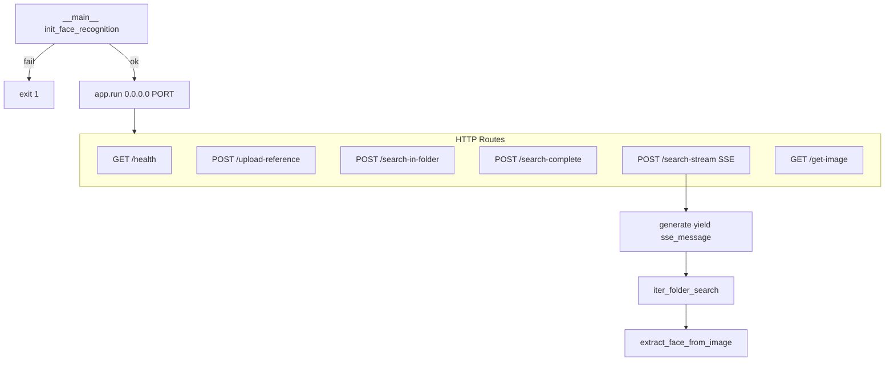
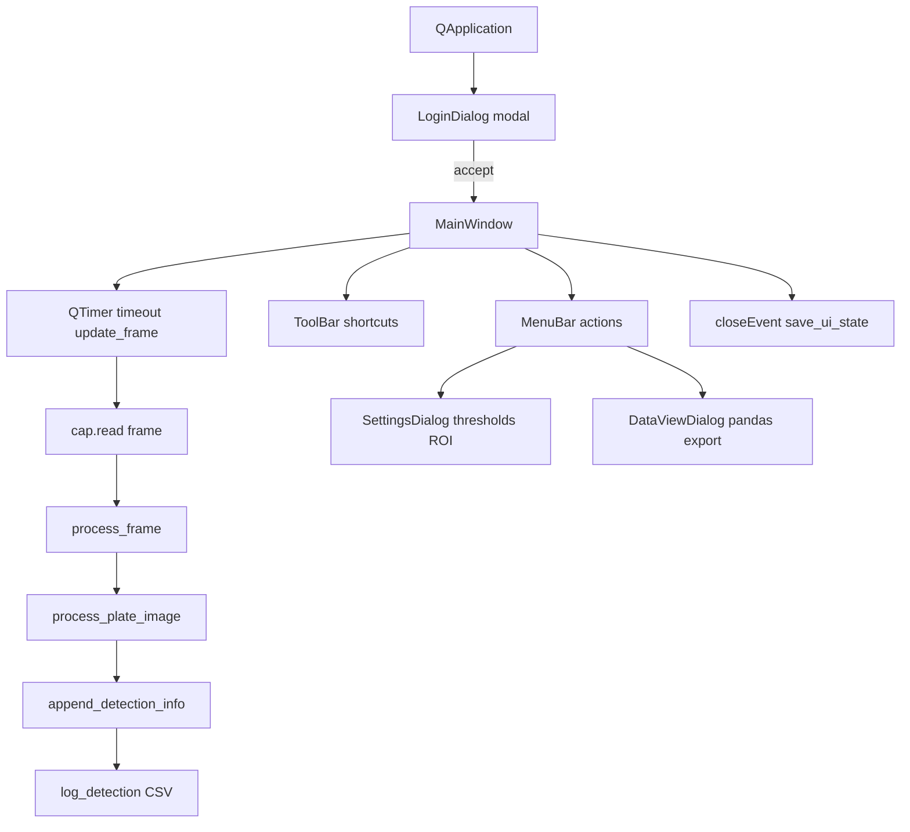
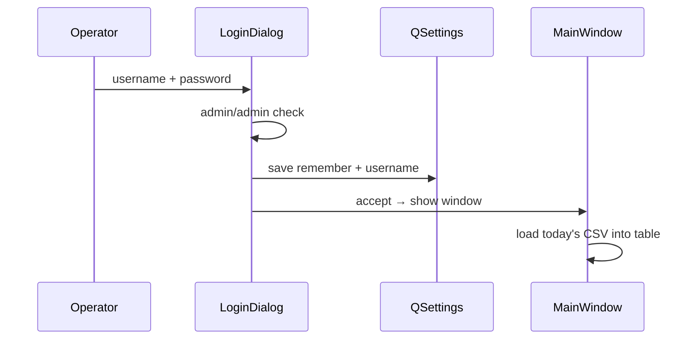
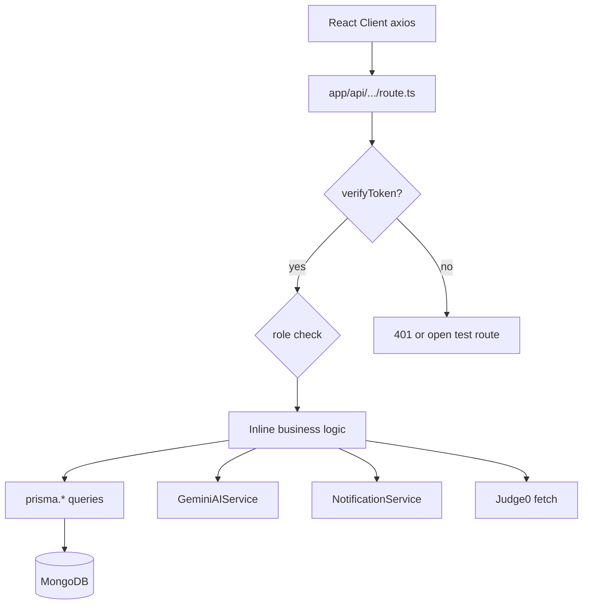
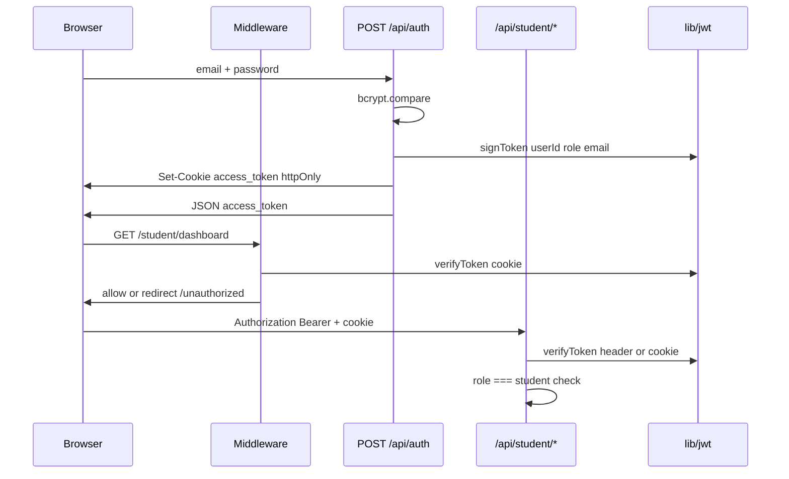

# Backend Engineering

**Related:** [[Software Architecture]] · [[API Design]] · [[Database Engineering]] · [[Security]] · [[Debugging]]

---

## Stack Comparison

| Component | Face Finder | NexusPath | Iink | MAPIMS | VocalAng | KVCET ANPR |
|-----------|-------------|-----------|------|--------|----------|------------|
| Framework | Flask + flask-cors | Next.js 16 App Router | FastAPI + Flask legacy | Express 5 (ES modules) | FastAPI | PySide6 Qt desktop |
| Real-time | SSE generator | Socket.IO (Pages API) | SSE | Deferred worker | FastRTC WebRTC + EventSource | QTimer 30ms frame loop |
| Runtime | Python 3, Flask dev server | Node 20, TypeScript | Python 3, uvicorn | Node 20 Alpine | Python, uvicorn | Python 3, local GUI |
| ODM/ORM | **None — filesystem only** | Prisma → MongoDB | pymongo direct | Mongoose 8 | None — in-memory dicts | None — CSV + JSON files |
| Auth | **None — localhost trust** | JWT httpOnly cookie + Bearer | Session cookie + Depends | POST login → localStorage | None — localhost | LoginDialog admin/admin + QSettings |
| Uploads | Base64 JSON body | Multipart certificate PDF → Mongo Bytes | Multipart PDF | Multer memory 60–80 MB | Base64 face images | QFileDialog video file |
| Long jobs | SSE folder scan generator | Gemini generation (sync in request) | SSE generator thread | `setImmediate` + poller | Generator yields TTS | Per-frame sync infer in timer |
| Cron | N/A | `/api/cron/*` with CRON_SECRET | N/A | N/A | N/A | N/A |
| External APIs | None — all local | Gemini, Judge0 RapidAPI | vLLM local | OpenRouter, Sarvam STT, EMR | Ollama local | None — all local models |

---

## Face Finder — Flask Backend



| Concern | Implementation | Notes |
|---------|----------------|-------|
| Business logic | Inline in route handlers + helper functions | No service layer |
| Validation | `if not image_input`, face count checks | No Pydantic/marshmallow |
| Error handling | try/except → `{success: false, error}` + traceback.print_exc | Exposes `str(e)` to client on 500 |
| Logging | `print()` with emoji prefixes | No structured logger |
| File I/O | `cv2.imread`, `Path.rglob`, `send_file` | Server-side path from client JSON |
| State | Global `face_app`, `execution_provider` | Single worker assumption |
| Background jobs | None — scan runs in request thread | SSE keeps connection open |
| CORS | `CORS(app)` — all origins | Dev-friendly; unsafe if networked |

**Startup fail-fast:** If `init_face_recognition()` returns False, process exits — no degraded API without model. Correct for CV service where all routes depend on inference.

**Model-not-loaded guard:** Every inference route checks `if face_app is None` → 500 — consistent defensive pattern.

---

## KVCET ANPR — Desktop "Backend" (No HTTP)

KVCET has **no server layer** — business logic lives in `MainWindow` methods triggered by Qt signals/slots.



| Concern | Implementation | Notes |
|---------|----------------|-------|
| Business logic | `MainWindow.process_frame`, `process_plate_image` | Inline — not extracted to service module |
| Validation | Confidence thresholds; empty plate skip | No schema validation library |
| Error handling | try/except + `QMessageBox` + `print()` | Operator-facing dialogs |
| Logging | CSV append + console print | No structured logger |
| File I/O | `csv.writer`, `json.dump`, `pd.read_csv` | Synchronous on detection path |
| State | Instance dicts `last_detection_times`, counters | In-memory session state |
| Persistence | QSettings org `KVCET` app `ANPR` | geometry, theme, auth remember |
| Background jobs | None — all on UI thread via QTimer | OCR blocks frame loop |

**Threading gap:** YOLO + PaddleOCR run on **main Qt thread** — long OCR can stutter UI. Acceptable at gate FPS; would need `QThread` worker for smoother UX.

**Auth flow:**


Placeholder credentials with comment `# replace with secure auth if needed` — same pattern as VocalAng (no auth) and MAPIMS (UI-only auth).

---

## NexusPath Business Logic Placement



**Core pattern:** Route handler = controller + service (not separated).

**Extracted services:**
- `lib/gemini-ai.ts` — LLM operations
- `lib/notification-service.ts` — notification CRUD + typed factories
- `lib/auth.ts` — `ensureFacultyRecord()` auto-provisioning

**Satellite:** `pages/api/socket.ts` — real-time messaging (not integrated with Message model writes).

---

## NexusPath Authentication Flow



**Dual transport:** Cookie for middleware-protected pages; Bearer for axios interceptor (`lib/api.ts`).

**Faculty auto-provision:** `ensureFacultyRecord()` creates `Faculty` row from `User` on first faculty action — bridges auth identity to domain model.

---

## Authorization — NexusPath

| Layer | Mechanism | Coverage |
|-------|-----------|----------|
| UI routes | `middleware.ts` ROLE_GUARDS | `/admin`, `/faculty`, `/student` |
| API routes | Per-handler `verifyToken` + role check | Inconsistent — some test routes open |
| Cron | `CRON_SECRET` Bearer | `/api/cron/notification-scheduler` |
| Socket | `authenticate` event with JWT | Pages API only |

**Gap:** Middleware matcher excludes `/api` — **API security is opt-in per route**, not framework-enforced.

**Example protected route pattern** (`daily-quiz-generate`):
```typescript
const token = request.headers.get('authorization')?.replace('Bearer ', '') ||
  request.cookies.get('access_token')?.value;
const decoded = verifyToken(token);
if (!decoded || decoded.role !== 'student') return 403;
```

**Example debt** (`generate-roadmap-suggestions`):
```typescript
// TODO: Re-enable authentication once the basic functionality works
// Auth commented out — endpoint publicly callable
```

---

## Validation — NexusPath

| Area | Approach | Gap |
|------|----------|-----|
| Login | email/password presence | No rate limiting |
| Roadmap create | year, careerPath, department required | No Zod schema |
| Code execution | code + languageId required | No code size limit |
| Certificate upload | file type/size in route | Partial |
| Faculty cross-dept | `canAssignCrossDepartment` flag | Server-side check in some routes |

**Style:** Inline `if (!field)` checks — no shared validation library.

---

## Error Handling — NexusPath

| Case | Response pattern |
|------|------------------|
| Auth fail | `{ error: 'Unauthorized' }` 401/403 |
| Login fail | Structured `{ error: { message, code: 'USER_NOT_FOUND' } }` |
| Gemini 429 | `{ errorType: 'RATE_LIMIT', retryAfter }` 429 |
| Gemini quota | `{ errorType: 'QUOTA_EXCEEDED', resetTime }` 429 |
| DB save fail after AI gen | Return generated content with temp ID — **fail forward** |
| Generic | `{ error: message }` 500 + console.error |

**Custom error classes:** `RateLimitError`, `QuotaExceededError` in `gemini-ai.ts` — typed errors propagate to HTTP layer.

**Philosophy:** Never lose AI-generated content on DB failure — return to client even if persist fails.

---

## Logging & Observability — NexusPath

| Mechanism | Purpose |
|-----------|---------|
| `console.log('Daily quiz generation API called')` | Route entry tracing |
| axios interceptors log token presence | Frontend auth debug |
| `console.log('⏳ Rate limited...')` | Gemini retry visibility |
| Emoji prefixes in cron (`🔄`, `✅`, `❌`) | Cron job scanability |
| `test-*` API routes | Manual integration probes |

**Missing:** Structured JSON logs, request IDs, correlation across Gemini + DB, APM.

---

## Background Jobs — NexusPath

**Cron route:** `POST /api/cron/notification-scheduler`

Protected by `CRON_SECRET` Bearer token. Runs synchronously in request:

1. Daily quiz reminders (idempotent — checks if sent today)
2. Daily test reminders
3. Workshop assignment reminders (24h window)
4. Course assignment reminders (due in 24h)
5. Submission deadline reminders (placeholder — schema gap)
6. Mentor talk reminders (placeholder)
7. Expired notification cleanup

**Idempotency pattern:**
```typescript
const existingReminders = await prisma.notification.findMany({
  where: { type: 'quiz', metadata: { contains: '"reminderType":"daily_quiz"' }, createdAt: { gte: todayStart } }
});
if (existingReminders.length > 0) return; // skip duplicate
```

**No queue system:** All work in HTTP request — long cron could timeout on large student body.

---

## File Handling — NexusPath

| Type | Storage | Route |
|------|---------|-------|
| Certificate PDF | MongoDB `Bytes` field | POST `/api/student/certificate-submission` |
| Certificate download | Stream from DB | GET `/api/certificate-files/[filename]` |
| Code submissions | String fields in DB | Assignment submit routes |

**Design choice:** PDF in Mongo — simple for prototype; scales poorly beyond ~16MB documents.

---

## File Handling — Face Finder

| Type | Transport | Route |
|------|-----------|-------|
| Reference image | Base64 in JSON body | POST `/upload-reference`, `/search-complete`, `/search-stream` |
| Folder scan target | Absolute path string in JSON | All search routes — **server reads local FS** |
| Match preview | Path query param | GET `/get-image?path=` → `send_file` |
| Face descriptor | 512-float array in JSON | `/upload-reference` response → `/search-in-folder` input |

**Design choice:** No upload of folder images to server — only path reference. Assumes Flask runs on same machine as photo library (or mounted volume). Client never receives raw image bytes except via `/get-image` proxy.

---

## Real-Time Streaming — Face Finder SSE

**Generator:** `iter_folder_search(reference_embedding, folder_path, threshold, max_results)`

| Event | Payload | Purpose |
|-------|---------|---------|
| `reference` | `{ mesh, bbox }` | Lock reference face overlay before scan |
| `start` | `{ total_images, threshold, folder_path }` | Initialize progress bar |
| `progress` | `{ scanned, total, current_image }` | Per-file heartbeat |
| `match` | Full match object + mesh | Incremental results grid |
| `done` | `{ matches, total_images_scanned, ... }` | Final sorted list |
| `error` | `{ error }` | Folder missing or exception |

**Headers:** `Cache-Control: no-cache`, `X-Accel-Buffering: no`, `Connection: keep-alive` — nginx/proxy compatibility (same pattern as Iink OCR SSE).

**Client:** `frontend/src/api.js` — manual ReadableStream parser, not native `EventSource` (POST body required).

---

## Real-Time Messaging — NexusPath

**File:** `pages/api/socket.ts`

| Event | Behavior |
|-------|----------|
| `authenticate` | JWT verify → join role room + user room |
| `join_room` / `leave_room` | Room management |
| `typing_start` / `typing_stop` | Typing indicators to recipient/room |
| `send_message` | Echo only — **not persisted to Message model** |

**Gap:** Socket layer disconnected from Prisma `Message`/`MessageRoom` models — dual messaging paths (REST `/api/realtime/*` vs Socket).

---

## NotificationService — NexusPath (Extracted Pattern)

Static class with typed factory methods:

| Method | Trigger |
|--------|---------|
| `createDailyQuizReminder` | Cron |
| `createWorkshopAssignmentNotification` | Workshop enroll |
| `createCourseAssignmentNotification` | Assignment due |
| `createSubmissionDeadlineReminder` | Priority by hours until due |
| `createMentorTalkNotification` | Priority by hours until talk |
| `createBulkDailyQuizReminders` | Cron batch |

**Priority escalation logic:**
```typescript
const hoursUntilDue = Math.ceil((dueDate - now) / 3600000);
priority = hoursUntilDue <= 24 ? 'urgent' : hoursUntilDue <= 48 ? 'high' : 'normal';
```

This is **domain logic done right** — extracted, reusable, testable in isolation.

---

## VocalAng / MAPIMS / Iink (Retained)

See prior vault content for FastRTC session lifecycle, MAPIMS deferred worker, Iink SSE orchestration.

---

## Face Finder Replication Checklist

1. Add `requirements.txt` with pinned insightface, onnxruntime-gpu, flask versions
2. Sanitize `/get-image` path — restrict to allowed roots
3. Extract `iter_folder_search` shared core — DRY three search endpoints
4. Add `multiprocessing.Pool` or job queue for folder scans >1000 images
5. Optional FAISS index if same folder searched repeatedly
6. Replace Flask dev server with gunicorn + gevent for production SSE

See [[Weaknesses]] for prioritized fixes.

---

## NexusPath Replication Checklist

1. Singleton Prisma — import from `lib/prisma.ts` only
2. Shared API auth middleware wrapper — `withAuth(['student'])`
3. Remove test routes from production build
4. Move Judge0 key to env
5. Wire Socket `send_message` to Prisma Message create
6. Migrate socket to App Router or custom server
7. Zod schemas for request bodies on mutation routes

See [[Weaknesses]] for prioritized fixes.
