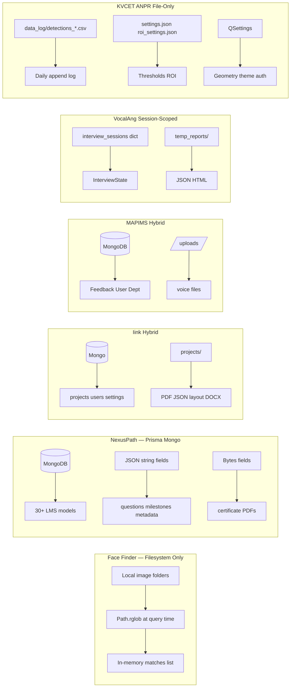
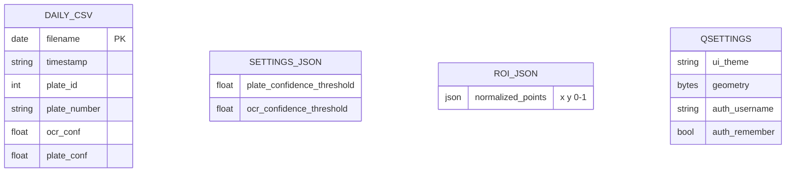
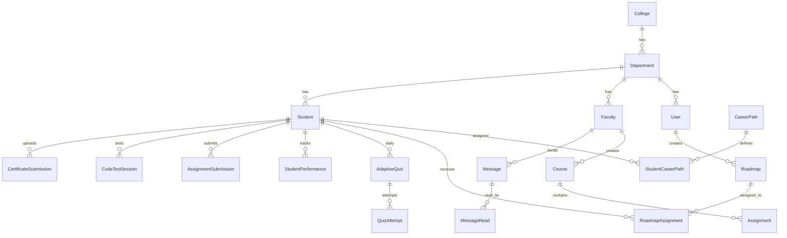

# Database Engineering

**Related:** [[Backend Engineering]] · [[Security]] · [[Software Architecture]] · [[Performance]]

---

## Storage Models — All Projects



NexusPath uses **MongoDB exclusively via Prisma** — no filesystem artifact store except certificate serving from DB bytes.

Face Finder uses **zero database** — deliberate for local privacy tool with no sync/multi-user requirements.

KVCET uses **zero database** — deliberate for offline gate PC with no DBA overhead.

---

## Face Finder Data Model

**No schema, no migrations, no ORM** — all state is ephemeral or filesystem-native.

### Implicit entities (in-memory / JSON only)

| Entity | Storage | Lifecycle |
|--------|---------|-----------|
| Reference embedding | Client holds 512-float array OR recomputed per request | Session-scoped in React state |
| Match result | SSE events + final JSON | Returned in `done` event; not persisted |
| Image file | Operator's disk | Read-only via `cv2.imread` |
| Face mesh | JSON in SSE `reference` / `match` events | Computed per detection; not stored |

### Folder scan contract

```python
IMAGE_EXTENSIONS = {'.jpg', '.jpeg', '.png', '.bmp', '.gif', '.webp', '.tiff'}
folder.rglob('*')  # recursive — all subfolders included
```

**No indexing:** Every search re-walks entire tree and re-embeds every face. Correct for prototype; **embedding cache keyed by `(path, mtime)`** would be first optimization.

### Why no database

| Alternative rejected | Reason |
|---------------------|--------|
| SQLite face index | Adds setup friction for personal tool |
| MongoDB embeddings | Overkill for single-user local scan |
| Pickle cache file | Could add later — not needed for v1 |

**Engineer pattern:** Same as KVCET CSV-only — **avoid DB ops tax** when data is read-once scan workload.

---

## KVCET ANPR Data Model

**No schema migration system** — CSV header written on first row of new daily file.

### Daily detection log (`detections_YYYY-MM-DD.csv`)

| Column | Type | Purpose |
|--------|------|---------|
| Timestamp | `YYYY-MM-DD HH:MM:SS` | Audit ordering |
| Plate ID | int | Session-scoped counter; reused within 60s dedup |
| Plate Number | string | Raw OCR output (spaces stripped) |
| OCR Confidence | float 0–1 | PaddleOCR best result |
| Plate Confidence | float 0–1 | YOLO detection score |

**Write pattern:** Append-only — `open(filename, "a")` with header if `not file_exists`.

**Read pattern:** `load_existing_detection_data()` on startup loads today's file into `QTableWidget`. `DataViewDialog` uses pandas for filter/export.



### Settings files

**`data_log/settings.json`:**
```json
{"plate_confidence_threshold": 0.4, "ocr_confidence_threshold": 0.4}
```

**`data_log/roi_settings.json`:**
```json
[{"x": 0.02, "y": 0.87}, {"x": 0.01, "y": 0.95}, ...]
```

**Why normalized ROI:** Window resize doesn't invalidate saved polygon — remapped via `pt.x() * label_width` on restore.

### Export operations (DataViewDialog)

| Operation | Method | Output |
|-----------|--------|--------|
| Export selected | `df.to_excel()` | Single-day xlsx |
| Export merged range | `pd.concat` across date-filtered files | Multi-day xlsx |
| Export ZIP | `zipfile.ZipFile` | Raw CSV bundle |

**Query "optimization":** Full file read into pandas — fine for days of gate traffic; would need SQLite if months of 24/7 logging.

### Data integrity

| Mechanism | Present? |
|-----------|----------|
| Transactions | No — append per detection |
| Unique constraints | No — OCR duplicates possible |
| Backup strategy | Operator copies `data_log/` folder |
| Reset | `reset_data()` deletes today's CSV + clears table |

---

## NexusPath Schema Architecture

**File:** `prisma/schema.prisma` — 842 lines, 30+ models



---

## Dual Identity Pattern — NexusPath

| Model | Purpose | Key fields |
|-------|---------|------------|
| `User` | Auth identity | email, password, role, departmentId |
| `Student` | Student domain profile | registerNumber, year, favoriteLanguage |
| `Faculty` | Faculty domain profile | assignedYears, canAssignCrossDepartment |

**Why separate:** Auth (`User`) decoupled from domain (`Student`/`Faculty`). Login uses `User`; LMS operations use profile records linked by email.

**Bridge pattern:** Routes lookup `User` by JWT userId, then `Student.findUnique({ where: { email: user.email } })`.

**Debt:** `User.plainPassword String?` — stores reversible password alongside bcrypt hash (provisioning convenience, security anti-pattern).

---

## JSON-in-String Pattern — NexusPath

AI-generated and flexible content stored as `String` fields containing JSON:

| Model | Field | Content |
|-------|-------|---------|
| `Roadmap` | milestones, careerOutcomes | Gemini-generated structure |
| `AdaptiveQuiz` | questions, performanceData | Daily quiz content |
| `Quiz` | questions, options, correctAnswers, explanations | Static quiz bank |
| `QuizAttempt` | answers, wrongAnswers, feedback | Attempt results |
| `CodeTestSession` | questions | Generated coding problems |
| `CodeTestQuestionResult` | testResults | Judge0 output |
| `Notification` | metadata | Reminder context |
| `Workshop` | prerequisites, objectives, materials | Array data |
| `IndustryMentor` | availability, preferences | Schedule JSON |

**Why:** Prompt output schema evolves weekly — Prisma migration per field change would block AI iteration.

**Trade-off:** No DB-level validation of JSON shape; parse errors at runtime; no query inside JSON without Mongo aggregation.

**Parse pattern used everywhere:**
```typescript
const milestones = typeof roadmap.milestones === 'string'
  ? JSON.parse(roadmap.milestones)
  : roadmap.milestones;
```

---

## Normalization Decisions — NexusPath

| Normalized | Denormalized | Why |
|------------|--------------|-----|
| StudentCareerPath junction | careerPath string on Roadmap | Junction for M:N; string for AI context |
| CourseEnrollment unique | enrolledStudents count on Course | Count denormalized for display speed |
| MessageRead per user | isRead on Message | Dual read tracking — partial normalization |
| FacultyCareerPath junction | assignedYears comma string | Junction proper; years as CSV string (query pain) |

**Comma-separated strings:** `Faculty.assignedYears`, `Faculty.allowedDepartments` — pragmatic for prototype filters; should be arrays or junction tables at scale.

---

## Indexing Strategy — NexusPath

Explicit indexes (sparse — most models unindexed):

| Model | Index | Purpose |
|-------|-------|---------|
| `CertificateSubmission` | status, studentId, evaluatedBy | Faculty queue filtering |
| `Workshop` | status, createdBy, isMandatory | Listing filters |
| `WorkshopEnrollment` | workshopId, studentId | Lookup |
| `Course` | status, createdBy, courseType | Admin filters |
| `CourseEnrollment` | courseId, studentId | Enrollment check |
| `Assignment` | courseId, dueDate | Deadline queries |
| `AssignmentSubmission` | assignmentId, studentId | Grading queue |
| `CourseRoadmapAssignment` | courseId, roadmapId, assignedBy | Join lookups |
| `MentorTalk` | scheduledDate, status, createdBy | Calendar views |
| `MentorTalkAttendance` | talkId, studentId | Registration |
| `IndustryMentorAssignment` | mentorId, studentId unique | Assignment |

**Gap:** No index on `Notification.createdAt` + `studentId` (hot query path). No index on `AdaptiveQuiz.quizDate` for daily quiz lookup. No `updatedAt` index for delta sync (unlike MAPIMS).

---

## Relationships & Integrity — NexusPath

**Cascade deletes:** Most student-child relations use `onDelete: Cascade` — student deletion cleans quiz history, enrollments, etc.

**Unique constraints:**
- `@@unique([studentId, careerPathId])` — no duplicate career assignments
- `@@unique([roadmapId, studentId])` — one assignment per roadmap per student
- `@@unique([workshopId, studentId])` — no double enrollment

**Schema bug:** `MessageRoomMember.userId` is `Int` while all other IDs are `String @db.ObjectId` — type inconsistency breaks room membership queries.

**Self-relation:** `Message.replyToId` → threaded conversations with `onDelete: NoAction`.

---

## Binary Storage — NexusPath

```prisma
model CertificateSubmission {
  certificateFile     Bytes
  certificateFileName String
  fileMimeType        String   @default("application/pdf")
  fileSize            Int
}
```

**Why Mongo Bytes:** Single-query fetch for faculty review; no S3 presigned URL complexity.

**Risk:** 16MB Mongo document limit; connection memory on large files; no CDN serving.

**Alternative path exists:** `GET /api/certificate-files/[filename]` — serves from DB bytes.

---

## Query Patterns — NexusPath

**Deep includes common:**
```typescript
student.roadmapAssignments.include.roadmap.include.courseAssignments.include.course.include.assignments
```

Used in daily quiz generation to extract skills — **N+1 risk** but single request via Prisma include tree.

**Simple list endpoints:** `courses-simple`, `workshops-simple` — selective fields, no deep includes (lite API pattern from MAPIMS influence).

**Bulk operations:**
```typescript
prisma.notification.createMany({ data: notifications })
```

---

## Migration Strategy — NexusPath

- Prisma `db push` workflow (prototype — no formal migration history evident)
- Schema comments reference PostgreSQL in `task.md` but actual provider is `mongodb`
- `engineType = "wasm"` — Prisma WASM engine for compatibility

**Evolution signal:** Task list says PostgreSQL; schema says MongoDB — **pragmatic pivot** during build without rewriting task docs.

---

## Transactions — NexusPath

**No explicit `$transaction` usage observed** — multi-step operations (create roadmap + learning resources) use nested `create` with relations or fail partially.

**Fail-forward example:** Roadmap route returns AI content even if DB save throws — data consistency not guaranteed.

---

## MAPIMS / Iink / VocalAng (Retained)

MAPIMS split-child ticket pattern, Iink hybrid FS, VocalAng intentional no-DB design — see prior vault sections.

---

## NexusPath vs MAPIMS Data Philosophy

| Aspect | NexusPath | MAPIMS |
|--------|-----------|--------|
| Delta sync | Not implemented | `sinceMs` incremental |
| Lite API | `*-simple` routes | `lite=1` query param |
| Split aggregates | Separate models per entity | Split child feedback rows |
| Index discipline | Sparse | More complete on Feedback |
| Client cache | None (relies on React state) | `feedbackCache` module singleton |

**Inference:** MAPIMS perf hardening knowledge **partially transferred** to NexusPath (lite routes) but not full sync/cache stack.

---

## Actionable Database Improvements

1. Add compound index `{ studentId, createdAt }` on Notification
2. Add `{ studentId, quizDate }` on AdaptiveQuiz
3. Fix MessageRoomMember.userId to ObjectId String
4. Remove User.plainPassword — use one-time reset flow
5. Extract JSON fields to subdocuments with Mongo native types (optional)
6. Add `$transaction` for roadmap create + resource create
7. Move certificate PDFs to GridFS or object storage

See [[Weaknesses]] and [[Learning Roadmap]].
