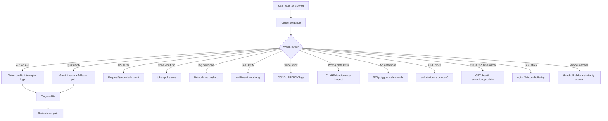
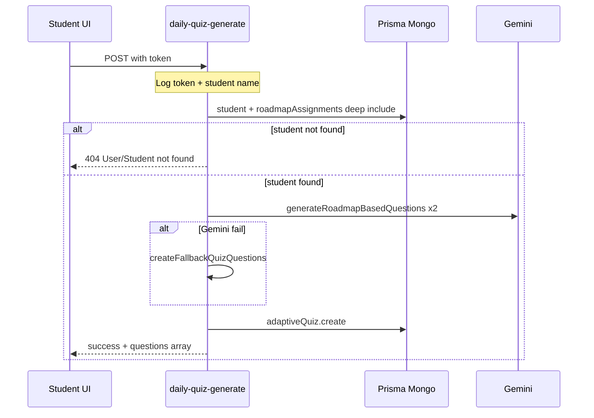

# Debugging Methodology

**Related:** [[Problem Solving]] · [[Engineering Profile]] · [[Backend Engineering]] · [[Performance]]

---

## Unified Debug Style

You debug **production-shaped systems** with **observable evidence** — Network tab, console logs, test API routes, standalone scripts, processing CSV, VRAM logs — not only stack traces.



---

---

## Face Finder Debugging Patterns

### 1. Health endpoint as integration probe
```javascript
// App.jsx — poll every 15s
checkHealth() → { model_loaded, execution_provider: 'cuda'|'cpu' }
```
Header badge shows CUDA vs CPU — first thing to check when matches are slow or missing.

### 2. Server startup logs
```
✅ InsightFace ArcFace (buffalo_l) loaded on CUDA
⚠️  CUDA requested but CPU is active — check cuDNN/CUDA install
❌ Failed to load InsightFace model: ...
```
Fail-fast on init — if service starts, model is loaded.

### 3. Per-file processing logs
```python
print(f"Processing {index}/{total}: {os.path.basename(image_path)}")
print(f"Error processing {image_path}: {str(e)}")
```
Bisect which file crashes inference vs returns no match.

### 4. CUDA preload verification
If `execution_provider == 'cpu'` but GPU expected:
1. Check `FACE_FINDER_FORCE_CPU` env
2. Verify pip packages: `nvidia-cudnn-cu12`, `onnxruntime-gpu`
3. Confirm `_preload_cuda_libs()` ran before import (module top)
4. Run `ort.get_available_providers()` — should include `CUDAExecutionProvider`

### 5. SSE vs REST bisection
Symptom: progress bar jumps instantly to 100%.

Trace:
1. Network tab — is response `text/event-stream` or JSON?
2. If JSON — client hit `runCompleteFallback` (404 or fetch error)
3. Check Vite proxy — `/api/search-stream` rewritten correctly?
4. If SSE — verify events in Response preview (chunked)

### 6. Match quality bisection
| Symptom | Check | Fix layer |
|---------|-------|-----------|
| Too many false positives | Lower threshold slider | Client threshold param |
| No matches found | Reference photo multi-face? | Upload validation |
| Wrong person matched | Similarity scores in response | Raise threshold |
| Mesh not showing | `reference` SSE event received? | Delaunay/scipy import |
| Images broken in grid | `/get-image?path=` 404 | Path encoding or file moved |

### 7. AbortController cancel test
Start scan → start new scan — `abortRef.current?.abort()` should cancel prior fetch without error toast (`AbortError` swallowed).

---

## NexusPath Debugging Patterns

### 1. Console.log as primary tracer
Heavy logging in route handlers and axios interceptors:

```typescript
console.log('API interceptor - Token check:', {
  hasToken: !!token, url: config.url
});
console.log('Daily quiz generation API called');
console.log('⏳ Rate limited (429). Retrying in...');
```

**When API fails:** Browser console shows token presence + response status + data JSON — bisect auth vs server vs Gemini without debugger.

### 2. Test API routes as integration probes
Dedicated debug endpoints left in codebase:

| Route | Purpose |
|-------|---------|
| `/api/test-db` | Database connectivity |
| `/api/test-gemini` | Gemini API key validation |
| `/api/test-judge0` | Judge0 RapidAPI connectivity |
| `/api/test-db-tables` | Schema table enumeration |
| `/api/simple-db-test` | Minimal query |

**Pattern:** Hit endpoint directly in browser/Postman to isolate layer before testing full UI flow.

### 3. Standalone scripts in `scripts/`
Operational debug outside Next.js runtime:

- `debug-quiz-history.js`
- `debug-certificate-submissions.js`
- `debug-execution-history.js`
- `test-db-storage.js`
- `create-sample-quiz-history.js`

**Use when:** Prisma query logic suspect — run script against live DB without UI noise.

### 4. Auth bisection
Symptom: 401 on student route.

Check sequence:
1. Browser console — axios interceptor `hasToken: false`?
2. Cookie present in Application tab?
3. Bearer header in Network request?
4. Route checks `decoded.role !== 'student'`?
5. User exists but Student profile missing?

**Known issue:** Token in localStorage vs cookie mismatch during development.

### 5. Gemini failure bisection
Symptom: quiz returns fallback questions only.

Trace:
1. Server log — `Error generating roadmap-based quiz`?
2. `llm_api_key` env set?
3. Response parse — `No valid JSON array found`?
4. Daily quota — `Daily request limit reached`?
5. Compare inline fetch URL vs `GeminiAIService` header style

### 6. Judge0 execution bisection
Symptom: code test hangs or errors.

Trace:
1. POST returns `token`?
2. GET poll — `status.id` progression (1=processing, 2=completed)?
3. `compile_output` base64 decoded?
4. RapidAPI key valid (hardcoded — check quota)?

### 7. Prisma connection issues
Symptom: intermittent DB errors under dev hot reload.

Hypothesis: multiple `new PrismaClient()` instances.
Verify: grep count of `new PrismaClient` — should be 1 singleton.

---

## NexusPath Debug Workflow Example

**Case:** Daily quiz not generating for student.



Check each arrow's log output to locate break point.

---

## VocalAng Debugging (Retained)

Timestamped `[CONCURRENCY]` tags, audio pipeline bisection, hallucination filter traces, GPU OOM on mode switch.

---

## MAPIMS Debugging (Retained)

Network tab first — MB payload before React blame; list vs detail field comparison; cache key mismatch.

---

## Iink Debugging (Retained)

Processing CSV step timings; mode bisection text-only vs layout_full; SSE reconnect.

---

## How You Test Assumptions — All Projects

| Assumption | Face Finder | NexusPath | MAPIMS | VocalAng | Iink |
|------------|-------------|-----------|--------|----------|------|
| Model loaded | `GET /health` model_loaded | N/A | N/A | Ollama /health | runtime endpoint |
| CUDA active | `execution_provider` field | N/A | N/A | nvidia-smi | GPU endpoint |
| API reachable | health poll 15s | `/api/test-db` | health route | /health | Mongo ping |
| AI key valid | `/api/test-gemini` | OpenRouter test | Ollama /health | runtime endpoint |
| Auth working | axios interceptor logs | manual fetch | N/A | session cookie |
| External API | `/api/test-judge0` | Sarvam test | verify_stt.py | force_process |
| Data shape | scripts/debug-*.js | Mongo shell | temp_reports/ file | page_N.json |

---

## How You Verify Fixes — NexusPath

1. Restart `next dev` (Prisma singleton + env reload)
2. Hit test route directly — confirm layer green
3. Full user path: login → student portal → trigger feature
4. Check server terminal for log sequence
5. Network tab — confirm response shape + payload size
6. For Gemini fixes — monitor 429 retry logs during burst test

---

## KVCET ANPR Debugging Patterns

### 1. QMessageBox as operator error surface
Every failure path shows dialog — operator reports exact message:
- `"CUDA GPU not available. Running YOLO on CPU (slower)."` — init path
- `"CUDA GPU not available. Cannot start detection."` — webcam block (inconsistent)
- `"Error loading CSV"`, `"Error saving ROI"` — file I/O

### 2. print() for developer traces
```python
print(f"Error in plate processing: {e}")
print(f"Error processing file {f}: {e}")
print("Error loading detection data:", e)
```
No log levels — grep console during file export failures.

### 3. Visual debug overlays
- **Red polygon** — ROI editing in progress
- **Blue polygon** — ROI finished OR fixed_area fallback
- **Green rectangles** — YOLO detections passing threshold
- **Green text** — Plate ID overlay on frame
- **Progress bars** — OCR (blue) vs plate (green) confidence in table

### 4. Status bar live metrics
`FPS:`, `Detections:`, `Mode: Webcam|File|GPU|CPU` — bisect perf vs detection vs input source without profiler.

### 5. Isolation workflow for ANPR bugs

| Symptom | First check | Layer |
|---------|-------------|-------|
| No plates detected | ROI scale — widget vs frame dimensions | Spatial |
| Garbage OCR | Save crop manually; test `process_plate_image` | Preprocessing |
| Duplicate CSV rows | `detection_interval` and plate text key | Dedup logic |
| App slow | FPS label; try ROI crop mode | Performance |
| Empty table on boot | Today's CSV path `detections_{date}.csv` | Persistence |
| Webcam won't start | `gpu_ready` flag vs CPU warning mismatch | Device init |

### 6. File-based reproduction
Upload recorded gate video via `upload_video()` — reproducible debug without live camera. Video loops on EOF for continuous testing.

---

## Debug Tooling Inventory

| Tool | Face Finder | NexusPath | MAPIMS | VocalAng | Iink | KVCET ANPR |
|------|-------------|-----------|--------|----------|------|------------|
| Console logs | print emoji | Heavy | `[feedback]` tags | `[CONCURRENCY]` | traceback | print + QMessageBox |
| Test API routes | GET /health | 6+ routes | health | /health | runtime | N/A |
| Health polling | 15s client interval | N/A | N/A | N/A | N/A | FPS status bar |
| Browser Network tab | SSE vs JSON bisect | axios debug | Primary tool | N/A | SSE monitor | N/A |
| Visual overlay | FaceMesh SVG landmarks | N/A | N/A | N/A | N/A | ROI boxes + conf bars |

---

## Signature Debug Mindset

> **Follow the bytes, the token, and the boundary.**

- **Face Finder:** health provider → SSE events → per-file log → similarity score → threshold
- **NexusPath:** auth token → route handler log → Prisma query → Gemini response → JSON parse
- **MAPIMS:** list API → cache → role filter → display field
- **Iink:** inference → cache → matcher → export
- **VocalAng:** VAD trigger → lock → STT → state machine → TTS yield
- **KVCET ANPR:** frame read → ROI scale → YOLO box → crop → preprocess → OCR conf → dedup → CSV row

See [[Problem Solving]] for task decomposition habits.
