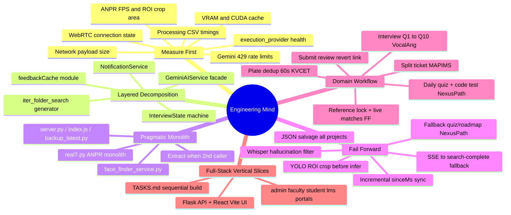

# Engineering Profile — UNIVERSO Reverse Engineering

> Reconstructed from **Face Finder** (local ArcFace search), **NexusPath** (AI LMS), **Iink** (VL document OCR), **MAPIMS Patient Feedback System** (hospital AI feedback + ticket routing), **VocalAng / ARIA** (real-time voice interview assistant), and **KVCET ANPR** (campus gate automatic number plate recognition).

**Related:** [[Software Architecture]] · [[AI Engineering]] · [[Backend Engineering]] · [[Skill Matrix]] · [[Weaknesses]] · [[Learning Roadmap]]

---

## Identity

You build **applied AI systems in operational contexts**, not demos. Evidence spans:

| Project | What you ship |
|---------|---------------|
| **Face Finder** | Reference selfie → 512-d ArcFace embedding → recursive folder scan → cosine match + SSE live progress + landmark mesh overlay |
| **NexusPath** | Role-based LMS → Gemini roadmaps/quizzes → Judge0 code tests → faculty-student messaging → career path orchestration |
| **Iink** | PDF → VL layout JSON → human Neural Review → XML/HTML/DOCX export |
| **MAPIMS** | Patient feedback (Tamil bot/voice/typed) → OpenRouter analysis → split tickets → HOD queue |
| **VocalAng** | WebRTC voice loop → Whisper STT → Ollama LLM → Kokoro TTS → 3D avatar lip-sync + interview reports |
| **KVCET ANPR** | Webcam/video → YOLO plate detect → ROI gate → PaddleOCR → deduped CSV log + export dashboard |

Shared practitioner traits:

- End-to-end ownership (API + AI + persistence + deploy + frontend glue)
- **Constraint-first** thinking (Gemini free tier 20/day, VRAM, payload MB, tab remount, EMR latency, WebRTC offline, GPU-only YOLO vs CPU OCR split, **ONNX CUDA library path hell**)
- **Iterative hardening** after user-visible pain (429 backoff → request queue → fallback content → lite API routes; **SSE stream → REST fallback**)
- Product workflow embedded in state machines (editorial states / ticket assignment / Q1→Q10 interview / quiz attempt limits / 60s plate dedup window / **scan progress events**)

---

## How You Think

You **start from the bottleneck** users feel (quiz generation timeout, 8 MB reload, GPU OOM, API 401 on remount, **CUDA requested but CPU active**) and fix the **narrowest layer** that removes it — rarely a full rewrite.

You prefer **Mongo for queryable records** (feedback, LMS entities) and **JSON strings inside documents** for AI-generated flexible content (quiz questions, roadmap milestones). **Binary in Mongo** when simplicity beats object storage (certificate PDFs). VocalAng uses **in-memory session dicts + flat files** when persistence is session-scoped. KVCET ANPR uses **daily CSV append logs + JSON settings files** when relational DB overhead is unnecessary for gate logging. Face Finder uses **zero database** — scan filesystem at query time; embeddings computed in-memory per request.

---

## Decision-Making Pattern

| Signal | Face Finder | NexusPath | Iink | MAPIMS | VocalAng | KVCET ANPR |
|--------|-------------|-----------|------|--------|----------|------------|
| Slow inference | Sequential folder scan; CUDA preload ctypes | RequestQueue 6s gap, 24h cache | VRAM tier, greedy decode | `lite=1`, `sinceMs` | Model hot-swap; rule validation | ROI crop before YOLO; OCR on CPU only |
| API quota hit | N/A — all local | RateLimitError, QuotaExceededError, fallback content | OCR disk cache | OpenRouter offload | `keep_alive=0`, unload on mode switch | N/A — all local models |
| Huge API payload | 512-float descriptor in JSON | `courses-simple`, `workshops-simple` | fingerprint cache | `toFeedbackListRow`, `feedbackCache` | Session-scoped | N/A — desktop only |
| UI remount reload | axios interceptors + cookies | Module singleton cache | SSE stream paint | EventSource reconnect | QSettings geometry + load today's CSV on startup |
| Real-time UX | SSE progress + match events | Socket.IO rooms + typing | SSE | Sarvam STT | FastRTC VAD + barge-in | QTimer 30ms frame loop + FPS EMA |
| GPU memory pressure | Single buffalo_l model global | N/A | VRAM tiers | N/A | Dual LLM swap | YOLO CUDA + PaddleOCR forced CPU |
| Stream unavailable | Client falls back to `/search-complete` | N/A | SSE reconnect | N/A | EventSource reconnect | N/A |

---

## Technical Signature (All Projects)

### Face Finder
1. **Extracted CV microservice** — originally `vocalang/face_finder/`; promoted to standalone repo with dedicated React UI
2. **InsightFace ArcFace buffalo_l** — 512-dimensional embeddings; cosine similarity threshold default 0.40
3. **CUDA ctypes preload hack** — `_preload_cuda_libs()` loads pip NVIDIA libs via `RTLD_GLOBAL` before ONNX Runtime import
4. **Execution provider detection** — `get_onnx_providers()` + `_detect_active_provider()`; `FACE_FINDER_FORCE_CPU` env override
5. **Multi-endpoint search API** — two-step (`/upload-reference` + `/search-in-folder`) vs one-shot (`/search-complete`) vs streaming (`/search-stream`)
6. **SSE event protocol** — `reference`, `start`, `progress`, `match`, `done`, `error` with `X-Accel-Buffering: no`
7. **Landmark mesh for UX** — 106-point `landmark_2d_106` or 5-point `kps`; Delaunay triangulation via scipy; normalized 0–1 coords for SVG overlay
8. **Client-side SSE parser** — manual buffer split + `fetch` ReadableStream; fallback simulates progress if stream 404
9. **Vite dev proxy** — `/api` → Flask `:5002` — same-origin pattern as MAPIMS/NexusPath dev ergonomics
10. **Local-trust security model** — no auth; `folder_path` and `get-image?path=` assume trusted operator on same machine

### NexusPath
1. **Next.js full-stack monolith** — App Router UI + `app/api/*` backend in one deployable unit
2. **Gemini as content factory** — roadmaps, quizzes, resources via structured JSON prompts
3. **`GeminiAIService` rate discipline** — queue manager, 429 exponential backoff, in-memory roadmap cache
4. **Dual AI integration paths** — centralized service vs inline fetch in route handlers (evolution artifact)
5. **Adaptive assessment loop** — `StudentPerformance` + `AdaptiveQuiz` + daily generation from roadmap context
6. **Judge0 code execution** — async submit/poll, base64 stdin/stdout, resource limits
7. **Role portal architecture** — `/admin`, `/faculty`, `/student`, `/lms` with middleware guards
8. **`NotificationService` domain factory** — typed notifications, bulk cron, idempotent daily reminders
9. **TASKS.md-driven build** — 48 sequential tasks, AI-verified checkpoints, prescribed Cursor prompts
10. **Documentation-as-architecture** — `TECHNICAL_DOCUMENTATION.md`, `COMPLETE_PROJECT_DOCUMENTATION.md`

### Iink
1. VL layout as source of truth (dots.mocr / vLLM / Chandra)
2. Spatial matcher for DOCX font fidelity
3. SSE long jobs with cancel + keepalive
4. Pipeline step toggles (`layout_full` vs `text_only`)

### MAPIMS
1. **LLM as triage engine** — sentiment, urgency, multi-issue split via OpenRouter
2. **Split-ticket data model** — one submission → N ticket rows (`submissionGroupId`)
3. **Lite list contract** — list views never ship bot transcripts
4. **Client-side cache + server delta** — `feedbackCache` + `sinceMs`
5. **EMR bridge** — QueryBuilder SOAP for UHID lookup
6. **Deferred AI** — fast HTTP 201, background poller

### VocalAng
1. **Full-duplex voice loop** — FastRTC WebRTC → Silero VAD → Whisper → Ollama → Kokoro TTS
2. **Dual-model VRAM strategy** — lightweight Qwen 0.8b vs Qwen3-4B GGUF; swap on `/set_mode`
3. **Hybrid interview control** — `InterviewState` state machine with rule-based validation
4. **Offline-first AI stack** — monkey-patch `hf_hub_download`; local `models/` dir
5. **Speech hygiene pipeline** — normalize, hallucination filter, empty-utterance TTS feedback
6. **Concurrency guards** — per-session processing lock, cooldown, duplicate skip

### KVCET ANPR
1. **Two-stage CV pipeline** — Ultralytics YOLO (`model/best.pt`) detects plates → OpenCV crop → PaddleOCR reads text
2. **Hybrid GPU/CPU inference** — YOLO on `cuda:0` when available; PaddleOCR forced `use_gpu=False` to avoid VRAM contention
3. **Spatial gating** — user-drawn polygon ROI (normalized coords) OR hardcoded `fixed_area` + `cv2.pointPolygonTest` on detection center
4. **OCR preprocessing chain** — grayscale → CLAHE → 1.5× resize → fastNlMeans denoise → SVTR_LCNet recognition
5. **Detection deduplication** — 60-second window per plate text; reuses Plate ID within window (gate traffic debounce)
6. **Daily CSV audit log** — append-only `data_log/detections_YYYY-MM-DD.csv`; reload on startup for session continuity
7. **Desktop operator UX** — PySide6 with webcam/file input, live detection table, confidence progress bars, Data View export (Excel/ZIP)
8. **Tunable thresholds** — plate_conf + ocr_conf persisted in `settings.json`; ROI in `roi_settings.json`
9. **Env compatibility hack** — `PADDLE_DISABLE_ONEDNN=1` before Paddle import (OneDNN runtime issues)
10. **Monolith iteration** — `real7.py` filename signals versioned prototype lineage (real1→real7)

---

## User & Problem Fit

### Face Finder users
**Individual operator or photographer** — wants to find all photos containing their face in a local folder (event albums, family archives, freelance deliverables).

**Problems solved:**
- Manual scrolling through thousands of event photos is impractical
- Privacy: runs entirely local — no cloud face API upload
- Live feedback during long scans via SSE progress + match toasts
- Visual confirmation via landmark mesh overlay on reference photo
- Tunable similarity threshold (0.25–0.75) for precision/recall tradeoff

**Balance:** Accept **714-line Flask monolith** and **sequential scan** when folder sizes are hundreds not millions — extract parallel workers only when measured pain appears.

### NexusPath users
**Admin** — college/department setup, user provisioning, analytics. **Faculty** — course/workshop creation, roadmap assignment, grading, messaging. **Student** — career dashboard, daily quiz, code tests, certificates, mentor talks.

### Iink users
Super_admin (OCR ops), admin (review/assign), user (layout correction).

### MAPIMS users
Patients/kiosk, staff, HOD, admin.

### VocalAng users
Students practicing technical interviews.

### KVCET ANPR users
**Campus security / ADS department operators** — gate staff monitoring vehicle entry at KVCET campus.

---

## Replication Guide

### To build like Face Finder
1. **Preload CUDA libs before ONNX import** — ctypes `CDLL` with `RTLD_GLOBAL`; patch `LD_LIBRARY_PATH` from pip `nvidia.*` packages
2. **Global singleton model** — one `FaceAnalysis.prepare()` at startup; fail fast if init fails (`exit(1)`)
3. **Cosine similarity on L2-normalized embeddings** — guard zero-norm edge case
4. **Best-face-per-image** — loop all detections; keep highest similarity above threshold
5. **Reference photo validation** — reject 0 faces and >1 faces with explicit error messages
6. **SSE generator for long scans** — yield progress per file; sort matches at end; include mesh in match payload for rich UI
7. **Client SSE parser with REST fallback** — don't assume EventSource; use fetch stream + simulate progress on fallback
8. **Health endpoint exposes `execution_provider`** — UI shows CUDA vs CPU badge; poll every 15s
9. **Vite proxy for dev** — `/api` rewrite strips prefix; production uses direct `:5002` URL
10. **Normalized landmark coords** — divide by image width/height for resolution-independent SVG overlay

### To build like NexusPath
1. **Role-scoped route trees** — `/api/student/*`, `/api/faculty/*` mirror portal boundaries
2. **Centralize LLM behind one service class** — queue, cache, custom errors, JSON salvage in one file
3. **Store AI output as JSON strings** in Mongo — schema stability without migration churn per prompt change
4. **Dual auth transport** — httpOnly cookie for SSR/middleware + Bearer for axios interceptors
5. **Lite API variants** — `courses-simple`, `workshops-simple` when list views bloat
6. **Fail-forward generation** — `createFallbackRoadmap()`, `createFallbackQuestions()` always return usable content
7. **Extract domain services early** — `NotificationService` static class pattern before route count explodes
8. **Cron with secret bearer** — `CRON_SECRET` protects scheduled notification batch jobs
9. **Extended AI timeouts on client** — separate `aiApi` axios instance at 120s vs 30s default
10. **Sequential task list** — `TASKS.md` with verification comments prevents scope drift

### To build like VocalAng
1. Patch HF downloads **before** importing FastRTC
2. Separate **fast validation** (rules) from **slow intelligence** (LLM) on hot audio path
3. Session state keyed by `webrtc_id`
4. Model warmup/unload per mode — never load both LLMs on consumer GPU
5. Filter Whisper hallucinations explicitly

### To build like Iink
1. Artifact contract per page (`page_N.json`)
2. Centralize inference behind `ocr_runtime`
3. SSE for long jobs; separate status poll for reconnect

### To build like MAPIMS
1. **List vs detail API split** — `lite=1` + `GET /feedback/:id`
2. **Incremental sync** — `updatedAt` index + `sinceMs`
3. **Module-level session cache** — instant paint on React remount
4. **Split domain entities early** — one AI issue = one ticket row

### To build like KVCET ANPR
1. **Detect-then-read pipeline** — never OCR full frame; YOLO bbox crop reduces OCR noise and latency
2. **Split GPU workloads** — heavy detector on CUDA; lighter OCR on CPU when VRAM is tight
3. **Normalize ROI coordinates** — store `[{x,y}]` as 0–1 fractions; scale to label size on restore, then to frame dimensions on infer
4. **Point-in-polygon gate** — `cv2.pointPolygonTest` on detection center filters false positives outside lane
5. **Preprocess before OCR** — CLAHE + denoise + upscale is cheaper than retraining OCR for glare
6. **Debounce by plate text** — 60s window prevents CSV spam when vehicle idles at gate
7. **Daily file rotation** — one CSV per day simplifies backup and date-range export without DB
8. **Persist session state on close** — QSettings for geometry, splitter, theme; reload today's CSV into table on boot
9. **Confidence thresholds as runtime knobs** — operators tune without code changes via Settings dialog
10. **Graceful video loop** — `cap.set(CAP_PROP_POS_FRAMES, 0)` on EOF for file-based testing

See [[Problem Solving]] and [[Debugging]] for operational habits.

---

## Engineering DNA Summary

| Dimension | Your pattern |
|-----------|--------------|
| Architecture | Monolith-first full-stack; extract services on second use; CV microservices when runtime diverges |
| AI integration | Cloud LLM for content gen; local models for voice/OCR/CV/face when privacy/latency demands |
| Data | Mongo + JSON blobs + selective binary; files for large artifacts; CSV daily logs for edge ANPR; **filesystem scan for face search** |
| API | REST role-scoped; lite variants; SSE for long jobs; async external poll (Judge0); desktop apps have no HTTP layer |
| Security | Design RBAC; implement UI first; API middleware often lagging; **local-trust path APIs need hardening** |
| Performance | Queue rate limits; cache AI responses; rule paths before LLM paths; ROI crop + GPU/CPU split; **CUDA lib preload** |
| Debug | Console logs + test routes + health probes + standalone scripts + QMessageBox operator feedback |
| Process | Vertical slice by user role; sequential TASKS; extensive markdown docs; versioned realN.py prototypes |
