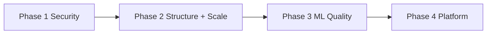

# Learning Roadmap

**Related:** [[Weaknesses]] · [[Skill Matrix]] · [[Engineering Profile]] · [[Security]] · [[AI Engineering]]

---

## Purpose

Close gaps from **Face Finder + NexusPath + Iink + MAPIMS + VocalAng + KVCET ANPR** without diluting core strengths: applied AI pipelines, full-stack product delivery, performance from measurement, workflow systems.

---

## Phase 0 — Face Finder Hardening (0–2 weeks)

**Goals:** Safe to run on LAN; reproducible install.

| Item | Outcome | Links |
|------|---------|-------|
| Add `requirements.txt` with pinned deps | Reproducible CUDA/CPU installs | [[Weaknesses]] |
| Path whitelist for `folder_path` + `get-image` | Block LFI / arbitrary read | [[Security]] |
| Bind `127.0.0.1` default or env `HOST` | Reduce network exposure | [[Security]] |
| Extract `_scan_folder()` shared function | DRY three search endpoints | [[Software Architecture]] |
| `VITE_API_BASE` env for production API URL | Fix hardcoded localhost:5002 | [[API Design]] |

---

## Phase 1 — NexusPath Security + MAPIMS Auth (0–6 weeks)

**Goals:** NexusPath deployable without secret leaks; MAPIMS safe on hospital LAN.

| Item | Outcome | Links |
|------|---------|-------|
| Move Judge0 key to env | No secrets in repo | [[Security]] |
| Remove `User.plainPassword` | No reversible passwords | [[Database Engineering]] |
| Fail startup without JWT_SECRET | No default secret | [[Security]] |
| `withAuth(roles)` route wrapper | Consistent API protection | [[Backend Engineering]] |
| Delete/gate test routes | No info disclosure | [[Weaknesses]] |
| Re-enable AI suggestions auth | Close public endpoint | [[API Design]] |
| JWT middleware MAPIMS Express | API receives credentials | [[Security]] |

---

## Phase 2 — Structure + Scale (4–10 weeks)

### NexusPath
| Item | Outcome |
|------|---------|
| Replace all `new PrismaClient()` with singleton | Connection stability |
| Migrate daily-quiz-generate to GeminiAIService | Single AI integration path |
| Wire Socket send_message to Prisma Message | One messaging path |
| Add pagination to student list endpoints | Bounded responses |
| Cron batch with cursor (500 students/batch) | No timeout |
| Client cache module (MAPIMS pattern) | Survive React remount |
| Zod schemas on mutation routes | Input validation |

### MAPIMS
| Item | Outcome |
|------|---------|
| Cursor pagination on GET /feedback | Bounded responses |
| Split index.js routers | Maintainability |

### VocalAng
| Item | Outcome |
|------|---------|
| Extract backup_latest.py modules | Maintainability |
| Fix response() lock race | Concurrency safety |

### Face Finder
| Item | Outcome |
|------|---------|
| Embedding cache keyed by `(path, mtime)` | Rescan same folder 10× faster |
| `concurrent.futures` for imread + CPU infer | Parallel I/O on large folders |
| Optional FAISS index module | Sub-linear search at 50k+ faces |
| pytest for `calculate_similarity`, `decode_base64_image` | First automated tests |
| gunicorn + gevent for SSE production | Replace Flask dev server |

### KVCET ANPR
| Item | Outcome |
|------|---------|
| Split `real7.py` → `cv_pipeline.py` + `ui/` | Testable modules |
| Fix `device=0` → use `self.device` | CPU fallback works |
| Unify GPU policy for webcam start | Consistent operator experience |
| Extract `_files_for_filter()` in DataViewDialog | DRY export logic |
| QThread worker for OCR | Smoother FPS |

**Skills gained:** API design ★★★★ → ★★★★★; Code organization ★★★ → ★★★★

---

## Phase 3 — AI Quality Systems (2–5 months)

### NexusPath
| Item | Outcome |
|------|---------|
| Golden set: 10 roadmap prompts + expected JSON schema | Regression gate |
| Golden set: 10 quiz prompts per career path | Quality baseline |
| Track fallback content rate metric | AI degradation signal |
| Either add Gemini to suggestions route or rename endpoint | Product honesty |
| Schema validate Gemini output with Zod before DB write | Parse reliability |

### MAPIMS
| Item | Outcome |
|------|---------|
| Golden set 30 Tamil/English feedbacks | Expected issues + sentiment |

### VocalAng
| Item | Outcome |
|------|---------|
| WER script on 10 golden audio clips | STT regression |

### Iink
| Item | Outcome |
|------|---------|
| Golden PDF pages | Layout tag expectations |

### KVCET ANPR
| Item | Outcome |
|------|---------|
| Golden set: 20 plate crop images + expected text | OCR regression |
| mAP eval on held-out gate video frames | Detector quality baseline |
| Track false positive rate by ROI mode | Spatial gating validation |

### Face Finder
| Item | Outcome |
|------|---------|
| Golden set: 50 face pairs with expected match/no-match | Threshold calibration baseline |
| LFW-style eval script on buffalo_l | Quantify FAR/FRR at 0.40 threshold |
| Benchmark folder scan throughput | Images/sec CUDA vs CPU |

**Skills gained:** ML evaluation ★★ → ★★★★

---

## Phase 4 — Platform Maturity (6–12 months)

| Track | Items |
|-------|-------|
| **Testing** | Vitest: GeminiAIService parse, NotificationService, InterviewState |
| **Testing** | Playwright: NexusPath login → daily quiz flow |
| **CI** | GitHub Actions: lint, vitest, prisma validate, docker build |
| **Observability** | Structured JSON logs, request_id on API routes |
| **NexusPath scale** | Redis for Gemini cache + Socket.IO adapter |
| **NexusPath storage** | Certificate PDFs to S3/GridFS |
| **Iink** | Job queue for OCR; deprecate Flask |
| **KVCET ANPR** | PyInstaller bundle + code signing; SQLite optional for multi-month logs |
| **Face Finder** | Docker compose Flask+frontend; optional auth layer for team deploy |
| **Optional AI** | RAG over resolved tickets — only if product asks |

**Skills gained:** DevOps ★★★★ → ★★★★★; Testing ★★ → ★★★★

---

## NexusPath-Specific Next Steps

1. **Unify AI path** — delete inline Gemini fetch in daily-quiz-generate
2. **API auth matrix doc** — table of every route + required role
3. **Fix MessageRoomMember.userId type** — schema migration
4. **Migrate socket to App Router** or custom server with Socket.IO
5. **Add `$transaction`** for roadmap + resources create
6. **Implement MAPIMS sinceMs pattern** for notifications/messages if lists grow
7. **Update task.md** — PostgreSQL → MongoDB correction

---

## MAPIMS-Specific Next Steps (Retained)

1. Auth + assignedToUserId enforcement
2. Shared useFeedbackList hook
3. Backend ticket-only endpoint

---

## KVCET ANPR-Specific Next Steps

1. **Real auth** — replace admin/admin with hashed local users
2. **Indian plate regex** — optional validation with operator override for OCR errors
3. **Move magic numbers to settings.json** — `fixed_area`, `detection_interval`, timer ms
4. **Version `model/best.pt`** — DVC or release asset with checksum
5. **pytest for `process_plate_image`** — mock PaddleOCR; test preprocessing chain
6. **Encrypt CSV at rest** — if gate PC is shared on campus network

---

## Face Finder-Specific Next Steps

1. **Path whitelist** — `ALLOWED_ROOTS` env for folder scan + image serve
2. **requirements.txt** — pin `insightface`, `onnxruntime-gpu`, `flask`, `flask-cors`, `opencv-python`, `scipy`
3. **README.md** — CUDA install steps, `_preload_cuda_libs` explanation, dev proxy setup
4. **Convert frontend to TypeScript** — optional; match NexusPath stack consistency
5. **Benchmark script** — `scripts/bench_scan.py` for images/sec on sample folder
6. **Consolidate search endpoints** — deprecate `/search-in-folder` if UI always uses stream

---

## VocalAng-Specific Next Steps (Retained)

1. Canonical file — git branches not backup copies
2. Session cleanup on disconnect
3. temp_reports/ rotation job

---

## Recommended Reading

| Topic | Why for your profile |
|-------|---------------------|
| Next.js Route Handlers auth patterns | NexusPath API middleware gap |
| Prisma MongoDB best practices | JSON field + connection pooling |
| Gemini API rate limits doc | Queue tuning validation |
| OWASP API Security Top 10 | MAPIMS + NexusPath auth gaps |
| Designing Data-Intensive Applications | Pagination, cron batching |
| WebRTC offline patterns | VocalAng depth |
| Judge0 API docs | Sandbox limit tuning |
| Ultralytics YOLO export docs | KVCET model deployment |
| PaddleOCR model list | SVTR_LCNet vs alternatives on CPU |
| OpenCV pointPolygonTest | ROI gating patterns |
| InsightFace model zoo docs | buffalo_l vs buffalo_s tradeoffs |
| FAISS indexing | Face Finder scale path |
| ONNX Runtime CUDA troubleshooting | ctypes preload patterns |

---

## What NOT to Prioritize Now

- Microservices before auth + singleton Prisma fix
- Kubernetes before Docker compose stable
- Vector DB / RAG before search is product requirement — **Face Finder FAISS only when folders exceed ~5k images measured**
- Rewriting NexusPath to separate Express backend — Next.js monolith is fine
- GraphQL migration — REST role namespaces work
- Replacing Gemini with local Ollama on NexusPath — cloud fits LMS content gen

---

## Weekly Practice (Maintain Strengths)

1. **One Network/GPU/quota audit** — payload MB, Gemini daily count, nvidia-smi, KVCET FPS label, or **Face Finder execution_provider**
2. **One user path walkthrough** — student daily quiz (NexusPath), Q1→report (VocalAng), gate video upload (KVCET), or **selfie upload → folder scan → match grid (Face Finder)**
3. **One security or test commit**
4. **One prompt experiment** with logged before/after on quiz quality
5. **Update this vault** when architectural decision made

---

## Vault Navigation

| Note | Use when |
|------|----------|
| [[Engineering Profile]] | Onboarding |
| [[Software Architecture]] | NexusPath folder or schema change |
| [[AI Engineering]] | Gemini prompt, quiz generation, ANPR pipeline, or **ArcFace threshold** change |
| [[Performance]] | Slow list, 429 errors, KVCET FPS/ROI tuning, or **Face Finder scan speed** |
| [[Debugging]] | Auth 401, quiz parse failure, OCR quality, or **CUDA CPU mismatch** |
| [[Security]] | Pre-deploy review |
| [[Weaknesses]] | Sprint planning |

---

*Updated by UNIVERSO — sources: Face Finder + NexusPath + Iink + MAPIMS Feedback System + VocalAng/ARIA + KVCET ANPR. Revise as systems evolve.*
