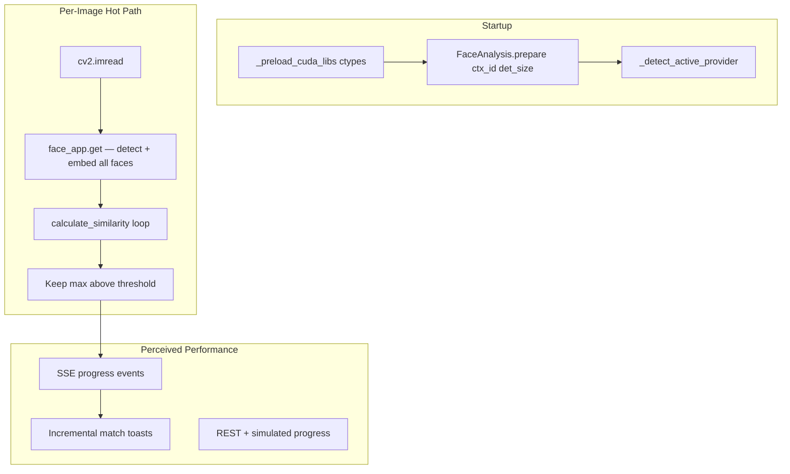
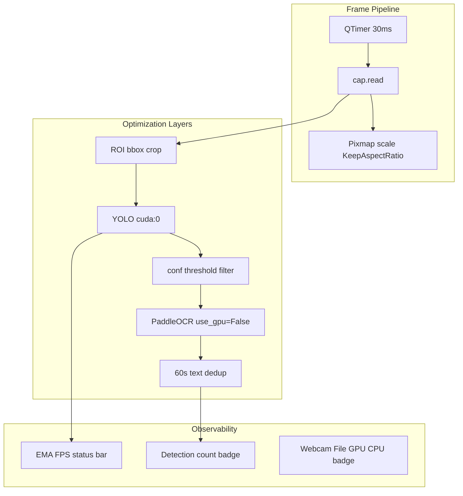
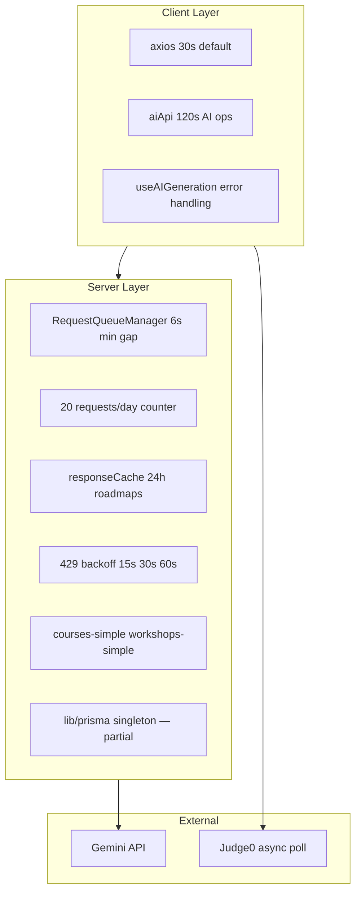
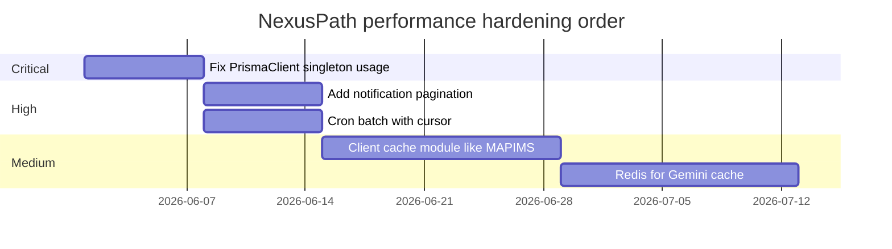

# Performance Engineering

**Related:** [[AI Engineering]] · [[Software Architecture]] · [[Backend Engineering]] · [[Weaknesses]]

---

## Performance Philosophy — Unified

Optimize where **users measure pain**:

| Project | Primary pain | Primary fix |
|---------|--------------|-------------|
| Face Finder | CUDA libs not found; sequential scan slow on 10k+ folders | ctypes preload + LD_LIBRARY_PATH; SSE progress UX |
| NexusPath | Gemini 429/timeouts, slow list endpoints, Prisma connection churn | Request queue, 24h cache, `*-simple` routes, aiApi 120s timeout |
| Iink | OCR seconds, GPU OOM | VRAM tiers, cache, vLLM parallel |
| MAPIMS | Multi-MB JSON reload | lite API, module cache, delta sync |
| VocalAng | GPU OOM, voice latency | Model hot-swap, int8 Whisper, rule validation, session locks |
| KVCET ANPR | Full-frame infer slow, VRAM contention, duplicate CSV rows | ROI crop, YOLO GPU + OCR CPU, 60s dedup, confidence thresholds |

Accept monolithic files if **hot paths are tunable** via env, query params, extracted helpers, or operator settings dialog.

---

## Face Finder Performance Stack



| Parameter | Value | Why |
|-----------|-------|-----|
| `det_size` | (640, 640) | InsightFace detect resolution — accuracy/latency tradeoff |
| `ctx_id` | 0 CUDA / -1 CPU | InsightFace GPU context selection |
| Scan order | Sequential `rglob` | Simple; no race conditions; GIL-bound |
| Global model | Single `face_app` | Avoid reload per request — ~seconds saved |
| SSE per file | One progress event | UI updates without waiting for full scan |
| Client health poll | 15s interval | Cheap; shows CUDA badge without blocking |
| Fallback sleep | 60ms per match | Simulates scan feel when SSE unavailable |

**Bottleneck analysis:**
- **GPU inference** dominates per-image time (~50–200ms depending on CUDA)
- **Filesystem walk** is O(n) files — `rglob` upfront in `iter_folder_search`
- **No batching** — each image is separate `face_app.get()` call; InsightFace supports batch but not used
- **No embedding cache** — same folder rescanned from scratch every time

**Optimization not yet implemented (engineer would add when measured):**
1. `concurrent.futures.ThreadPoolExecutor` for I/O-bound `imread` + CPU fallback
2. FAISS index if folder >5000 faces
3. Pickle cache `{path: (mtime, embedding)}` sidecar
4. Skip non-image early via extension set (already done)

---

## KVCET ANPR Performance Stack



| Parameter | Value | Why |
|-----------|-------|-----|
| Timer interval | 30ms | ~33 FPS target for gate monitoring |
| FPS smoothing | EMA α=0.1 | Readable status bar |
| ROI inference | Crop before YOLO | Smaller tensor → faster detect |
| OCR upscale | 1.5× | Accuracy/latency tradeoff |
| Dedup window | 60s | Prevent idle vehicle log spam |
| Default thresholds | 0.4 / 0.4 | Balanced precision/recall starting point |
| Video loop | Reset frame 0 on EOF | File testing without manual restart |

**GPU gate inconsistency:** `start_webcam()` blocks if `not gpu_ready` with "CUDA GPU not available" — but model init allows CPU fallback with warning. Operator may be blocked from webcam on CPU-only machine despite partial CPU support.

**Hardcoded device:** `self.model(roi, device=0)` ignores `self.device` — bug if running CPU mode.

---

## NexusPath Performance Stack



---

## Gemini Rate Limiting — NexusPath

**Class:** `RequestQueueManager` in `lib/gemini-ai.ts`

| Parameter | Value | Why |
|-----------|-------|-----|
| `minDelayBetweenRequests` | 6000ms | ~10 req/min free tier safety |
| `dailyLimit` | 20 | Free tier daily cap |
| Retry on 429 | 15s → 30s → 60s + jitter | Exponential backoff |
| `maxRetries` | 3 | Fail fast after ~2 min |
| Roadmap cache TTL | 24 hours | Same params = no re-call |
| `maxOutputTokens` | 4096→3000→2000 | Token cost reduction per method |
| `temperature` | 0.5 roadmaps, 0.7 quizzes | Consistency vs variety |

**Queue serialization:** All Gemini calls go through single queue — prevents parallel burst triggering 429.

**Daily limit reset:** Rolling 24h from first request — not calendar day (approximation of free tier).

---

## Client Timeout Strategy — NexusPath

```typescript
// lib/api.ts
const api = axios.create({ timeout: 30000 });      // CRUD operations
const aiApi = axios.create({ timeout: 120000 });   // Roadmap/quiz generation
```

**Why separate instances:** Roadmap generation with 6-8 milestones exceeds 30s regularly; CRUD should fail fast.

**Frontend hook:** `useAIGeneration` maps timeout errors to user-friendly `TIMEOUT` errorType with retry guidance.

---

## Database Performance — NexusPath

| Technique | Status | Impact |
|-----------|--------|--------|
| Prisma singleton (`lib/prisma.ts`) | Partial — ~40 routes use `new PrismaClient()` | Connection pool exhaustion under load |
| Deep includes | Used in quiz generation | Single query vs N+1 — good |
| `createMany` bulk insert | Notifications cron | Efficient batch writes |
| Indexes | Sparse — see [[Database Engineering]] | Missing on hot Notification queries |
| JSON string storage | All AI content | Fast writes; no index inside JSON |
| Pagination | **Not implemented** | Full student/course lists |

**Lite API pattern:**
- `GET /api/student/courses-simple` — reduced joins/fields
- `GET /api/student/workshops-simple` — dashboard-optimized

Directly influenced by MAPIMS `lite=1` discipline.

---

## Judge0 Execution — NexusPath

| Limit | Value | Purpose |
|-------|-------|---------|
| cpu_time_limit | 2.0s | Prevent infinite loops |
| wall_time_limit | 5.0s | Total execution cap |
| memory_limit | 128000 KB | Sandbox memory |
| base64_encoded | true | Binary-safe transport |
| wait=false | async submit | Non-blocking API response |

**Client poll pattern:** Frontend submits code → receives token → polls GET until `status.id > 2` — offloads wait from server.

---

## Caching — NexusPath

| Cache | Location | TTL | Scope |
|-------|----------|-----|-------|
| Roadmap responses | `GeminiAIService.responseCache` Map | 24h | In-process memory — lost on restart |
| Prisma query | None (no Redis) | — | — |
| Client-side | None (no feedbackCache equivalent) | — | React component state only |
| Next.js | Default static/cache headers | Route-dependent | — |

**Gap vs MAPIMS:** No module-level client cache surviving React remount — NexusPath relies on cookie auth + refetch.

---

## Cron Performance — NexusPath

`notification-scheduler` runs **7 sequential job functions** in one HTTP request:

| Job | Pattern | Risk |
|-----|---------|------|
| Daily quiz reminders | Idempotent check + `createMany` | O(students) in one request |
| Workshop reminders | Nested loop workshops × enrollments | N×M inserts |
| Course reminders | Nested loop assignments × enrollments | N×M inserts |

**No batching limit** — 10,000 students could timeout Vercel/serverless function.

---

## VocalAng Performance (Retained)

VRAM model hot-swap, int8 Whisper, rule validation skipping LLM, concurrency locks — see prior vault.

---

## MAPIMS Performance (Retained)

Lite API, feedbackCache, sinceMs delta sync — NexusPath adopted lite routes but not full sync stack.

---

## Resource Management — NexusPath

| Resource | Management | Gap |
|----------|------------|-----|
| Prisma connections | Singleton exists but bypassed | Pool leak |
| Gemini quota | Queue + daily counter | No persistent quota tracking across restarts |
| Memory | No streaming for large PDFs | Certificate upload loads full buffer |
| Socket.IO | In-memory Map | Single instance only |

---

## Optimization Priority — NexusPath



See [[Weaknesses]] and [[Learning Roadmap]].
