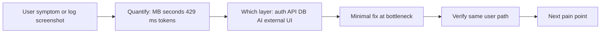
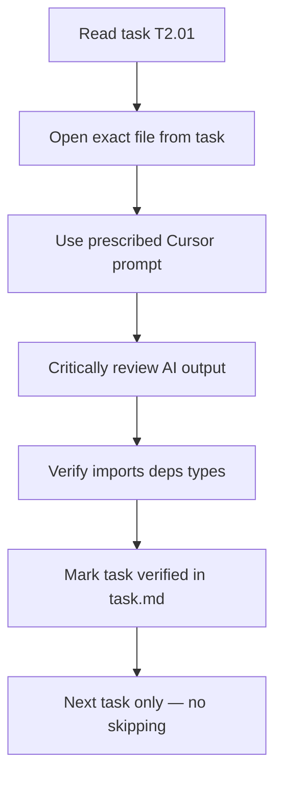

# Problem Solving

**Related:** [[Engineering Profile]] · [[Debugging]] · [[AI Engineering]] · [[Weaknesses]]

---

## Approach to Unknown Problems



You **bias toward shipping fixes** on the critical path over architectural purity — but fixes are **evidence-led**, not guess-led.

---

## Task Decomposition — Face Finder (Inferred)

| Large goal | Subtasks shipped |
|------------|------------------|
| Working face match | InsightFace init → cosine similarity → folder rglob |
| CUDA reliability | ctypes preload → LD_LIBRARY_PATH patch → provider detection |
| VocalAng extraction | Separate repo → port 5002 → standalone service |
| Rich scan UX | SSE generator → progress events → live match toasts |
| Reference confirmation | landmark mesh → Delaunay → FaceMesh SVG overlay |
| Dedicated UI | React Vite app → SearchPanel → ResultsGrid → health badge |
| Resilient client | Manual SSE parser → REST fallback → AbortController |
| Dev ergonomics | Vite proxy `/api` → Flask rewrite |

**Pattern:** **Extract microservice when parent monolith stack diverges**, then **add product UI** when API-only is insufficient — same arc as MAPIMS lite API then dashboard.

---

## Face Finder — Problem-Solving Examples

| Problem | Approach | Layer fixed |
|---------|----------|-------------|
| ONNX can't find cuDNN | ctypes preload pip nvidia libs | Bootstrap / env |
| CUDA requested, CPU active | `_detect_active_provider()` + warning print | Observability |
| Long scan feels frozen | SSE progress + match events | API protocol |
| SSE blocked by proxy | Client fallback to `/search-complete` | Transport resilience |
| Multi-face reference noise | Reject >1 face with 400 error | Input validation |
| Mesh overlay resolution mismatch | Normalize landmarks to 0–1 | Coordinate space |
| Service down in UI | 15s health poll disables search | Client guard |

---

## Task Decomposition — NexusPath (Observed)

| Large goal | Subtasks shipped |
|------------|------------------|
| Full LMS prototype | 48 tasks in `task.md` — 6 phases, backend+frontend pairs |
| AI roadmaps | Gemini service → rate queue → fallback → faculty route → DB persist |
| Daily adaptive quiz | Roadmap skill extraction → dual quiz types → AdaptiveQuiz model → cron reminder |
| Code testing | Judge0 integration → async poll → CodeTestSession results → Monaco editor UI |
| Role portals | middleware guards → layout.tsx per role → scoped API namespaces |
| Real-time messaging | Socket.IO setup → typing indicators → REST message routes (partial integration) |
| Notifications | NotificationService extract → typed factories → cron scheduler → idempotent daily |
| Certificate workflow | PDF upload to Mongo Bytes → faculty review queue → grade/comment |
| Career path system | StudentCareerPath junction → faculty assignment → cross-dept permissions |
| Account provisioning | Bulk provision API → plainPassword storage (debt) → faculty create-student |

**Pattern:** **TASKS.md vertical slices** — each task targets one file with prescribed Cursor prompt; verification comment on completion.

---

## TASKS.md Workflow — NexusPath



**Engineering process insight:** You treat AI as co-pilot with **strict sequential guardrails** — local filesystem as source of truth (no git dependency in rules).

**Phase structure:**
1. Foundation Setup (Next.js, Prisma, env)
2. Authentication System
3. Admin Portal
4. Faculty Portal
5. Student Portal
6. AI Integration
7. Real-time Features
8. Testing & Deployment

---

## Task Decomposition — VocalAng (Retained)

Offline voice → HF patch → model download → VAD tuning → concurrency locks → barge-in → report generation.

---

## Task Decomposition — MAPIMS (Retained)

Network analysis → lite API → sinceMs → feedbackCache → HOD server filter → split tickets.

---

## Task Decomposition — Iink (Retained)

Text-only OCR, RBAC workflow, vLLM parallel, PaddleOCR removal.

---

## Prioritization Heuristics — Unified

1. **Blocks user entirely** — login fail, quiz won't load, code won't execute, no audio
2. **Wrong behavior** — wrong role access, hallucinated content, incorrect scores
3. **External service limits** — Gemini 429, Judge0 quota — queue/cache/fallback
4. **Speed after correctness** — lite routes, AI cache, delta sync
5. **UX polish** — notification emojis, loading states, error messages in hooks
6. **Debt** — auth middleware, Prisma singleton, test route removal, extract services

You accept **temporary dual paths** (inline Gemini + GeminiAIService; Socket + REST messaging) if demo ships on deadline.

---

## Experimentation Style — NexusPath

| Technique | Example |
|-----------|---------|
| Test API routes | `/api/test-gemini` to validate key before UI integration |
| Auth temporarily disabled | `generate-roadmap-suggestions` — comment out auth to test logic |
| Fallback content | Disable Gemini → verify fallback quizzes appear |
| Script isolation | `scripts/debug-quiz-history.js` — test DB query without UI |
| Env toggles | `llm_api_url`, `llm_model` swap models |
| Dual axios timeouts | 30s vs 120s — experiment with generation wait |
| Console-driven tracing | Add logs → reproduce → remove after fix |

---

## Iteration Loop — NexusPath Gemini Case Study

```mermaid
cycle
    title NexusPath Gemini reliability iteration
    "Quiz generation fails silently" --> "Add console logs to route"
    "JSON parse errors" --> "Add regex salvage + fence strip"
    "429 rate limits" --> "Build RequestQueueManager"
    "Still hitting daily cap" --> "Add 24h roadmap cache"
    "Frontend shows generic error" --> "Build useAIGeneration hook with errorType"
    "Some routes still unprotected" --> "Per-route verifyToken pattern"
```

Each iteration triggered by **observed failure during user path testing**, not upfront design.

---

## Handling Ambiguity — NexusPath

| Ambiguous report | Resolution approach |
|------------------|---------------------|
| "AI suggestions don't work" | Check if route uses LLM or rule-based — `/api/ai/generate-roadmap-suggestions` is **heuristic not Gemini** |
| "Student can't access course" | Bisect middleware vs API vs enrollment record |
| "Quiz questions not personalized" | Trace `extractRoadmapInfo()` — empty if no roadmap assignments |
| "Notifications duplicated" | Check cron idempotency query for today's date |
| "Code test timeout" | Judge0 poll loop vs 30s axios timeout mismatch |

---

## Product-Driven Problem Solving — NexusPath

You solve **institutional LMS workflows**, not generic CRUD:

- Career path assignment across departments with permission flags
- Faculty assigns roadmap → links to courses → daily quiz pulls course assignment titles for skill extraction
- Certificate PDF faculty review with grade — not auto-verified by AI
- Industry mentor talks with attendance + feedback — event lifecycle

**Technical choices serve these workflows** — JSON strings for AI content because faculty prompts change weekly; not because it's architecturally ideal.

---

## Anti-Patterns Consciously Accepted — NexusPath

| Pattern | When rational |
|---------|---------------|
| 100+ route files with inline logic | Cursor AI one-file-one-task workflow |
| JSON strings in Mongo | AI schema volatility |
| Test routes in production code | Rapid integration validation |
| Auth disabled on one AI route | Debug during build — must re-enable |
| plainPassword field | Bulk account provisioning for students |
| Socket + REST dual messaging | Real-time prototype before full integration |

See [[Weaknesses]] for when to outgrow each.

---

## Task Decomposition — KVCET ANPR (Inferred)

| Large goal | Subtasks shipped in `real7.py` evolution |
|------------|------------------------------------------|
| Working ANPR at gate | YOLO load → webcam loop → bbox draw |
| Readable plates | PaddleOCR integration → preprocessing chain |
| Reduce false positives | fixed_area polygon → user-drawn ROI |
| Operator tuning | Settings dialog thresholds → JSON persist |
| Audit trail | CSV daily log → Data View export |
| Production polish | Login gate → theme toggle → QSettings persist → toolbar shortcuts |
| Performance visibility | FPS EMA → confidence progress bars → status badges |

**Pattern:** **Versioned monolith filename** (`real7.py`) — each `realN` iteration adds capability without repo structure overhead. Same spirit as VocalAng `backup_latest.py` naming.

---

## KVCET ANPR — Problem-Solving Examples

| Problem | Approach | Layer fixed |
|---------|----------|-------------|
| OCR fails on glare | CLAHE + denoise preprocessing | Image pipeline |
| Too many detections | 60s dedup + confidence thresholds | Business logic |
| Slow inference | ROI crop before YOLO | Spatial optimization |
| GPU OOM with both models | YOLO CUDA, PaddleOCR CPU | Resource split |
| Camera moved | Normalized ROI save/load | Coordinate persistence |
| Operator needs history | Daily CSV + pandas DataView | File-based analytics |
| Paddle OneDNN crash | `PADDLE_DISABLE_ONEDNN=1` env | Runtime compatibility |

**Iteration style:** Fix the **visible operator pain** (missed plates, slow FPS, CSV spam) before refactoring into modules.

---

## Cross-Project Problem Solving Signature

| Trait | Manifestation |
|-------|---------------|
| Measure first | Network tab, 429 logs, GPU monitor |
| Fix narrowest layer | Cache before rewrite; queue before new infra |
| Fail forward | Fallback content always available |
| Sequential build | TASKS.md, phase gates |
| Extract on reuse | NotificationService, GeminiAIService after pain |
| Document decisions | TECHNICAL_DOCUMENTATION.md, this vault |
| Edge deploy pragmatism | KVCET: no DB; Face Finder: no DB, filesystem scan |
| Microservice extraction | Face Finder from VocalAng when CV stack + UX diverged |
| Versioned prototypes | realN.py, backup_latest.py — ship then consolidate |
