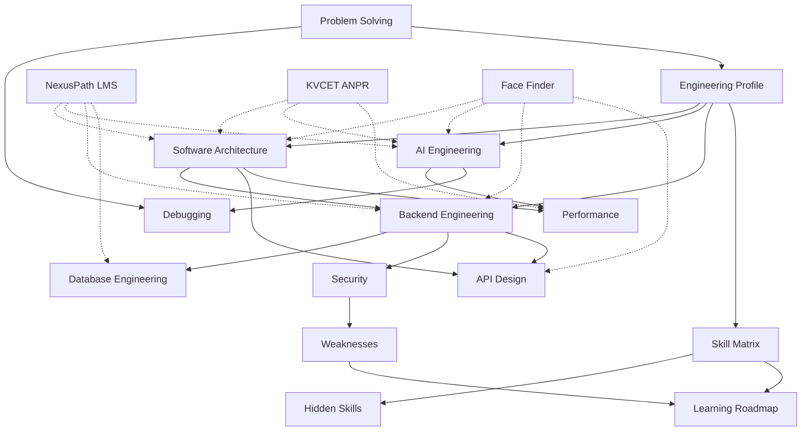

# Engineering DNA — Index

> Obsidian vault reverse-engineered by **UNIVERSO** from six production codebases:
> **Iink** (document OCR / VL pipeline), **MAPIMS Feedback System** (hospital patient feedback + AI tickets), **VocalAng / ARIA** (real-time voice interview assistant), **NexusPath** (AI-powered LMS — Next.js full-stack), **KVCET ANPR** (campus automatic number plate recognition — PySide6 desktop CV pipeline), and **Face Finder** (local ArcFace face search — Flask + React SSE).

Open [[Engineering Profile]] first for the complete narrative.

---

## Vault Map

---

## Files

| Note | Focus |
|------|-------|
| [[Engineering Profile]] | Mindset, six-project signature, replication guide |
| [[Software Architecture]] | Monolith patterns, hybrid storage, folder WHY |
| [[AI Engineering]] | VL OCR + LLM triage + voice + Gemini LMS + ANPR CV + **ArcFace face search** |
| [[Backend Engineering]] | FastAPI/Express/Next.js/Flask, WebRTC, cron, SSE generators |
| [[Database Engineering]] | Mongo + FS, Prisma 30-model LMS schema, **filesystem-only Face Finder** |
| [[API Design]] | REST, SSE, WebRTC, lite/delta, role-scoped routes |
| [[Performance]] | GPU tiers, VRAM swap, Gemini queue, cache, ROI crop, **CUDA ctypes preload** |
| [[Security]] | RBAC intent vs execution gaps, **path traversal LFI** |
| [[Debugging]] | Network tab, artifacts, console bisection, health probes |
| [[Problem Solving]] | Vertical slices, TASKS.md workflow, SSE fallback pattern |
| [[Hidden Skills]] | Cross-domain capabilities |
| [[Weaknesses]] | Debt + actionable fixes |
| [[Skill Matrix]] | Star ratings (all six projects) |
| [[Learning Roadmap]] | 4-phase growth plan |

---

## Source Repositories

| Project | Path | Domain |
|---------|------|--------|
| **Face Finder** | `/home/durga/Desktop/Freelance/face_finder` | Local face search — reference photo → folder scan → cosine match |
| **NexusPath** | `/run/media/durga/project/Profectus/nexuspath-prototype` | AI LMS — career paths, adaptive quizzes, code tests, messaging |
| **Iink** | `/run/media/durga/New Volume/Iink` | Textbook OCR, VL layout, editorial workflow |
| **MAPIMS Feedback** | `/home/durga/Desktop/PROJECT_MAPIMS/feedbacksystem` | Hospital feedback, AI tickets, Tamil bot, EMR lookup |
| **VocalAng / ARIA** | `/run/media/durga/project/vocalang` | Voice interview practice, WebRTC, 3D avatar |
| **KVCET ANPR** | `/run/media/durga/project/peer/kvcet_vehicle` | Campus gate ANPR — YOLO + PaddleOCR desktop client |

**Face Finder key paths:**
- `face_finder_service.py` — Flask monolith (~714 lines): InsightFace init, CUDA preload, folder scan, SSE stream
- `frontend/src/api.js` — SSE parser, AbortController, fallback to `/search-complete`
- `frontend/src/App.jsx` — health polling, live match state, toast queue
- `frontend/vite.config.js` — dev proxy `/api` → `localhost:5002`
- `frontend/src/components/FaceMesh.jsx` — Delaunay landmark overlay from server mesh payload

**KVCET ANPR key paths:**
- `real7.py` — PySide6 monolith (~2910 lines): video loop, detection, OCR, UI, export
- `model/best.pt` — custom Ultralytics YOLO weights (plate detector)
- `data_log/detections_YYYY-MM-DD.csv` — append-only daily detection logs
- `data_log/settings.json`, `data_log/roi_settings.json` — tunable thresholds + normalized ROI polygon
- `requirements.txt` — pinned CV stack (torch 2.8, ultralytics 8.3, paddleocr 2.10, PySide6 6.9)

**NexusPath key paths:**
- `app/api/*` — ~100 App Router route handlers (student/faculty/admin/ai/cron)
- `prisma/schema.prisma` — 30+ MongoDB models (LMS domain)
- `lib/gemini-ai.ts` — `GeminiAIService`, rate queue, JSON salvage, fallbacks
- `lib/notification-service.ts` — typed notification factory + bulk cron helpers
- `lib/auth.ts`, `lib/jwt.ts`, `middleware.ts` — JWT cookie + role guards
- `pages/api/socket.ts` — Socket.IO real-time (Pages router legacy)
- `app/api/code-execution/route.ts` — Judge0 async submit/poll
- `hooks/useAIGeneration.ts` — frontend AI error taxonomy (429, quota, timeout)
- `task.md`, `TECHNICAL_DOCUMENTATION.md` — sequential build + architecture docs

**VocalAng key paths:**
- `backup_latest.py` — FastAPI + FastRTC monolith (~3.5k lines)
- `face_finder/face_finder_service.py` — original InsightFace microservice (extracted → standalone repo)
- `BACKUP_LATEST_DOCUMENTATION.md` — system workflow doc

**MAPIMS key paths:**
- `backend/src/index.js`, `openRouterAnalysis.js`, `pendingAiWorker.js`
- `frontend/src/app/lib/feedbackCache.ts`, `feedbackListSync.ts`

**Iink key paths:**
- `server.py`, `iink_engine/*`, `project_manager.py`, `dots.mocr/`

---

## Cross-Project Themes

All six codebases share the same engineer fingerprint:

1. **Applied AI over research** — ship pipelines (OCR, triage, voice, quiz/roadmap gen, ANPR, **face search**), not papers
2. **Monolith-first** — extract modules when reuse appears (`GeminiAIService`, `feedbackCache`, **standalone Face Finder from VocalAng**)
3. **Hybrid persistence** — Mongo for records; JSON strings for AI blobs; files for artifacts/PDFs; **filesystem scan for Face Finder**
4. **Settings/env toggles** — `llm_api_*`, CRON_SECRET, `FACE_FINDER_FORCE_CPU`, behavior change without rewrites
5. **Human-in-the-loop** — editorial review (Iink) / HOD tickets (MAPIMS) / interview scoring (VocalAng) / faculty grading (NexusPath) / **threshold slider (Face Finder)**
6. **Performance from measurement** — Network tab, Gemini 429 backoff, VRAM, payload size, **CUDA provider detection**
7. **Fail-forward AI** — JSON salvage, fallback quizzes/roadmaps, rule-based suggestions when LLM unavailable; **SSE → REST fallback on Face Finder client**
8. **Pragmatic security** — RBAC designed; API hardening often deferred (MAPIMS, NexusPath `/api` bypass, **Face Finder path traversal**)

---

## How to Use This Vault

1. **Onboard engineers** → Profile + Architecture + relevant AI note
2. **NexusPath LMS incident** → Backend + Database + API Design + Security
3. **MAPIMS perf incident** → Performance + Debugging + API Design
4. **Iink OCR incident** → Debugging + AI Engineering + Performance
5. **VocalAng voice/WebRTC issue** → AI Engineering + Debugging + Performance
6. **KVCET ANPR detection/OCR issue** → AI Engineering + Performance + Debugging
7. **Face Finder CUDA / match quality** → AI Engineering + Performance + Debugging
8. **Face Finder security review** → Security + Weaknesses (get-image LFI)
9. **Security review** → Security + Weaknesses
10. **Planning sprint** → Weaknesses + Learning Roadmap

Cross-links use Obsidian wikilinks. Follow **Related:** headers at the top of each note for navigation.
