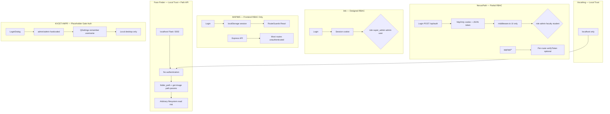
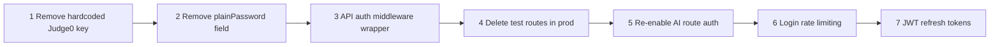

# Security Engineering

**Related:** [[Backend Engineering]] · [[API Design]] · [[Database Engineering]] · [[Weaknesses]]

---

## Security Model Comparison



---

## Face Finder Security Posture

**Threat model:** Local developer/photographer tool on single machine — **trusted operator assumed**. Becomes **critical** if Flask binds `0.0.0.0` on networked host.

| Aspect | Implementation | Risk |
|--------|----------------|------|
| Authentication | None | **Critical** if exposed beyond localhost |
| Authorization | None | Any client can trigger folder scan |
| CORS | `CORS(app)` — all origins | Enables cross-origin abuse if networked |
| Path traversal | `GET /get-image?path=/etc/passwd` | **Critical LFI** — no path sanitization |
| Folder injection | `folder_path` from JSON body | Server reads arbitrary directories |
| Error disclosure | `str(e)` in 500 responses | Stack info via traceback.print_exc server-side |
| Base64 bomb | No size limit on reference image | Client limits 10MB; server unbounded |
| Bind address | `host='0.0.0.0'` | Listens all interfaces — not localhost-only |
| Secrets | None in repo | Good — no API keys |
| Data privacy | Local processing only | Good — photos never leave machine |

**Why acceptable for v1:** Same pattern as VocalAng localhost trust — tool built for operator's own photos on own machine.

**If deployed beyond localhost:**
1. Bind `127.0.0.1` only or add reverse proxy with auth
2. Whitelist allowed roots for `folder_path` and `get-image`:
   ```python
   ALLOWED_ROOTS = [Path("/home/user/photos").resolve()]
   def safe_path(p): ...
   ```
3. Add API key or session auth middleware
4. Restrict CORS to frontend origin
5. Cap base64 decode size (e.g. 10MB server-side)
6. Rate-limit search endpoints

---

## NexusPath Security Posture

**Threat model:** Institutional LMS on college network or cloud — **partially hardened, prototype gaps remain**.

| Aspect | Implementation | Risk |
|--------|----------------|------|
| Password storage | bcrypt hash on `User.password` | Good |
| Plaintext password | `User.plainPassword` field stored | **Critical** — reversible credential storage |
| JWT secret | `process.env.JWT_SECRET \|\| 'supersecret'` | **Critical** — default secret in dev/prod if unset |
| Cookie flags | httpOnly, secure in production, sameSite lax | Good |
| UI authorization | middleware.ts role guards | Good for pages |
| API authorization | Per-route opt-in | **Gap** — middleware excludes `/api` |
| Test endpoints | `/api/test-db`, `/api/test-gemini` open | Info disclosure |
| AI endpoint auth | `generate-roadmap-suggestions` auth disabled | Abuse vector |
| Judge0 API key | Hardcoded in source file | **Critical** — secret in repo |
| Cron auth | CRON_SECRET Bearer | Good pattern |
| Certificate PDF | Stored in Mongo Bytes | No virus scan; size limit unclear |
| Socket auth | JWT on authenticate event | Good; but message send not validated |

---

## NexusPath Authentication Detail

**Login flow** (`app/api/auth/route.ts`):
- bcrypt.compare against stored hash
- Structured error codes: `USER_NOT_FOUND`, `INVALID_PASSWORD`, `LOGIN_ERROR`
- Sets httpOnly cookie + returns token in JSON (dual delivery)

**Token payload:**
```typescript
{ userId: string, role: string, email: string }
// expiresIn: '1h'
```

**Client transport** (`lib/api.ts`):
- Reads token from storage via `getTokenFromStorage()`
- Injects `Authorization: Bearer` header
- `withCredentials: true` for cookie co-transport

**Middleware matcher:**
```typescript
matcher: ['/((?!_next/static|_next/image|api|assets|.*\\.png$).*)']
```
**Explicitly excludes all `/api` routes** — API security is developer discipline, not framework enforcement.

---

## NexusPath Authorization Gaps

| Route category | Auth status | Should be |
|----------------|-------------|-----------|
| `/api/student/*` | Mostly protected | All protected |
| `/api/faculty/*` | Mostly protected | All protected |
| `/api/admin/*` | Protected | Protected |
| `/api/ai/generate-roadmap-suggestions` | **Open** | Student auth |
| `/api/test-*` | **Open** | Dev only / removed |
| `/api/simple-db-test` | **Open** | Removed |
| `/api/code-execution` | **Open** | Student auth + rate limit |
| `/api/cron/*` | CRON_SECRET | Good |

**Student accessing faculty routes:** Blocked if route checks role — but inconsistent coverage.

**Admin impersonation:** Admin role included in `/student` and `/faculty` middleware guards — intentional superuser access.

---

## Input Validation — NexusPath

**Present:**
- Required field checks on roadmap creation
- bcrypt password verification
- Role string comparison on routes
- Judge0 base64 encoding (prevents raw binary issues)
- JSON parse try/catch on AI responses

**Missing:**
- Request body schema validation (no Zod/Yup)
- Code submission size limits
- PDF upload MIME verification beyond client
- Rate limiting on login endpoint
- CSRF tokens (SameSite lax mitigates partially)
- SQL injection N/A (MongoDB via Prisma — parameterized)

---

## Secrets Management — NexusPath

| Secret | Storage | Status |
|--------|---------|--------|
| DATABASE_URL | .env | Correct |
| JWT_SECRET | .env (with bad default) | Fix default |
| llm_api_key | .env | Correct |
| CRON_SECRET | .env | Correct |
| Judge0 RapidAPI key | **Hardcoded in route.ts** | **Move to env immediately** |

---

## Data Protection — NexusPath

| Data | Protection | Gap |
|------|------------|-----|
| Passwords | bcrypt | plainPassword field undermines |
| Student PII | MongoDB access via API | No field-level encryption |
| Certificate PDFs | Mongo Bytes | No access audit log |
| Quiz answers | JSON in DB | Faculty can view via admin routes |
| Faculty messages | Message model | No end-to-end encryption |

---

## MAPIMS Security (Retained — Still Critical)

No API authentication middleware — **highest production risk** among all projects if deployed.

---

## VocalAng Security (Retained)

Localhost trust boundary — acceptable for dev tool; not for cloud without auth layer.

---

## Iink Security (Retained)

Designed RBAC with `_require_project_access` — reference model for NexusPath API middleware.

---

## Security Hardening Priority



---

## KVCET ANPR Security Posture

**Threat model:** Campus gate workstation — physical access assumed; **cosmetic login only**.

| Aspect | Implementation | Risk |
|--------|----------------|------|
| Authentication | `admin`/`admin` hardcoded in `LoginDialog.try_login()` | **Critical** if networked — trivial bypass |
| Password storage | None — plaintext compare | N/A for placeholder |
| Remember me | QSettings stores username only | Low — no password persisted |
| Data at rest | CSV files in `data_log/` — world-readable on disk | Medium — plate numbers are PII |
| Network exposure | None — no HTTP server | **Low** — air-gapped by architecture |
| Model files | Local `model/best.pt` | Supply chain if weights tampered |
| Input validation | Video file extension filter only | Low — local operator trust |

**Comment in code:** `# Simple credential check; replace with secure auth if needed` — engineer acknowledges debt.

**Why login exists at all:** Operator accountability UX (`User: admin` badge) + remember-me for shared gate PC — not security boundary.

**If deployed beyond lab:**
1. Hash passwords via local SQLite user table or Windows AD integration
2. Encrypt CSV at rest or restrict `data_log/` ACLs
3. Add audit log for export actions
4. Code-sign the PyInstaller bundle

---

## Cross-Project Security Maturity

| Control | Face Finder | NexusPath | MAPIMS | Iink | VocalAng | KVCET ANPR |
|---------|-------------|-----------|--------|------|----------|------------|
| Password hashing | N/A | ★★★★ | ★★★ | ★★★ | N/A | ★ |
| API auth | ★ | ★★ | ★ | ★★★ | ★ | N/A |
| RBAC design | ★ | ★★★★ | ★★★★ | ★★★★★ | ★ | ★ |
| RBAC execution | ★ | ★★★ | ★ | ★★★★ | ★ | ★ |
| Secrets hygiene | ★★★★★ | ★★ | ★★★ | ★★★ | ★★★ | ★★★ (no secrets) |
| Input validation | ★★ | ★★ | ★★ | ★★★ | ★★★ | ★★ |
| Path traversal protection | ★ | ★★★ | ★★★ | ★★★ | ★★ | ★★★ |
| Data privacy | ★★★★★ | ★★★ | ★★★★ | ★★★ | ★★ | ★★ (CSV PII) |

See [[Weaknesses]] for actionable fixes and [[Learning Roadmap]] for learning path.
