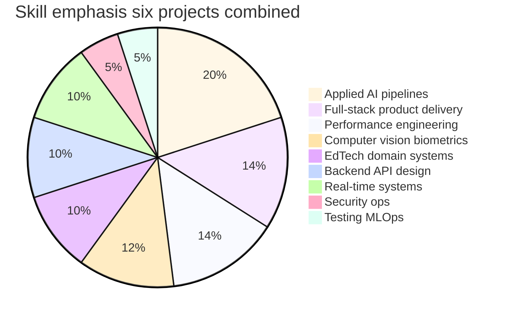

# Skill Matrix

**Related:** [[Hidden Skills]] · [[Engineering Profile]] · [[Weaknesses]] · [[Learning Roadmap]]

Rating key:
- ★★★★★ Expert — novel solutions; could teach
- ★★★★ Advanced — production patterns; some gaps
- ★★★ Intermediate — functional; inconsistent depth
- ★★ Beginner — exposure only
- ★ Basic — minimal evidence

Evidence column cites **all six projects** where applicable.

---

## Core Engineering

| Skill | Rating | Evidence |
|-------|:------:|----------|
| Software architecture | ★★★★★ | Iink engine; MAPIMS lib extraction; VocalAng voice monolith; NexusPath 4-portal Next.js; KVCET ANPR edge desktop; **Face Finder microservice extraction + React UI** |
| System design | ★★★★★ | SSE OCR; lite/delta API; offline outbox; VocalAng offline WebRTC; NexusPath role-scoped API; KVCET detect-read-dedup; **Face Finder SSE scan protocol + REST fallback** |
| Backend engineering | ★★★★★ | FastAPI + Express + Next.js + **Flask SSE**; deferred workers; cron; NotificationService; KVCET Qt event-loop |
| API design | ★★★★ | lite/sinceMs/detail MAPIMS; VocalAng mode endpoints; NexusPath 100+ routes; **Face Finder multi-endpoint search evolution + SSE events**; KVCET internal UI contracts |
| Database design | ★★★★ | MAPIMS indexes + split schema; NexusPath 30-model LMS; JSON-in-string AI pattern; Iink hybrid; KVCET daily CSV; **Face Finder intentional no-DB** |
| Code organization | ★★★ | lib/ extractions good; six god files across projects; **Face Finder clean frontend/backend split** |
| Modularity | ★★★★ | Extract on reuse (GeminiAIService, NotificationService, feedbackCache, ocr_runtime, **Face Finder from VocalAng**) |
| Maintainability | ★★★ | Settings/env help; TASKS.md process; zero tests hurt all projects; **Face Finder missing requirements.txt** |
| Documentation | ★★★★★ | TECHNICAL_DOCUMENTATION.md, COMPLETE_PROJECT_DOCUMENTATION.md, task.md, Engineering DNA vault |
| Technical writing | ★★★★★ | Prompts, system docs, verification logs, this vault |

---

## AI / ML

| Skill | Rating | Evidence |
|-------|:------:|----------|
| AI engineering (applied) | ★★★★★ | Iink VL OCR; MAPIMS LLM triage; VocalAng STT→LLM→TTS; NexusPath Gemini; KVCET YOLO+PaddleOCR; **Face Finder ArcFace 1:N search** |
| ML engineering | ★★★★ | Inference opt Iink; deferred worker MAPIMS; VocalAng int8 Whisper; NexusPath rate queue; KVCET GPU/CPU split; **Face Finder CUDA ctypes bootstrap** |
| Computer vision | ★★★★★ | Iink PDF raster; VocalAng InsightFace; KVCET ANPR; **Face Finder embedding search + landmark mesh** |
| NLP / document AI | ★★★★ | Iink layout IR; MAPIMS Tamil; VocalAng prompts; NexusPath structured JSON; KVCET plate OCR |
| Prompt engineering | ★★★★★ | Iink layout; MAPIMS XML JSON-only; VocalAng Phi-3; NexusPath roadmap/quiz templates + salvage |
| Speech / voice AI | ★★★★★ | MAPIMS Sarvam; VocalAng full pipeline |
| Real-time audio / WebRTC | ★★★★ | VocalAng FastRTC; NexusPath Socket.IO (partial) |
| RAG | ★ | Not present |
| Agents / tool use | ★ | Not present |
| Embeddings / vector DB | ★★★ | **Face Finder cosine 1:N brute force**; VocalAng face embeddings; no ANN index yet |
| Model evaluation | ★★ | Human review; threshold tuning; no metrics CI |
| Inference optimization | ★★★★★ | Iink GPU tiers; MAPIMS payload + defer; VocalAng model swap; NexusPath queue + cache; KVCET ROI crop; **Face Finder global model singleton + CUDA preload** |

---

## Frontend Engineering

| Skill | Rating | Evidence |
|-------|:------:|----------|
| React architecture | ★★★★ | NexusPath role portals + hooks; MAPIMS router guards; VocalAng R3F avatar; **Face Finder scan session state + toast queue** |
| Real-time UI integration | ★★★★ | NexusPath Socket.IO hooks; VocalAng EventSource/WebRTC; **Face Finder SSE ReadableStream parser** |
| Client performance | ★★★★ | MAPIMS feedbackCache; NexusPath lite routes + aiApi timeout; **Face Finder AbortController + SSE fallback** |
| Offline-first UX | ★★★★ | MAPIMS IndexedDB outbox; VocalAng offline models; **Face Finder local-only processing** |
| TypeScript | ★★★★ | NexusPath throughout; Face Finder uses JS (not TS) |
| 3D / WebGL | ★★★ | VocalAng Three.js |

---

## Operations & Quality

| Skill | Rating | Evidence |
|-------|:------:|----------|
| Performance engineering | ★★★★★ | GPU Iink; network MAPIMS; VRAM VocalAng; Gemini queue NexusPath; ROI crop KVCET; **CUDA preload Face Finder** |
| Security engineering | ★★★ | Iink RBAC designed; MAPIMS/NexusPath API gaps; **Face Finder path traversal if networked** |
| DevOps / Docker | ★★★★ | Iink + MAPIMS compose; NexusPath Next.js deploy-ready; KVCET/Face Finder desktop — no container |
| Testing / QA automation | ★★ | verify_stt.py; scripts/ manual; zero unit tests all projects |
| Debugging | ★★★★★ | test routes NexusPath; Network tab MAPIMS; concurrency VocalAng; visual overlay KVCET; **health provider Face Finder** |
| Observability | ★★★ | Console tags; execution_provider health; no APM anywhere |

---

## Integration & Domain

| Skill | Rating | Evidence |
|-------|:------:|----------|
| Enterprise integration | ★★★★ | EMR SOAP MAPIMS; Judge0 NexusPath |
| Healthcare domain | ★★★★ | MAPIMS OP/IP, tickets |
| EdTech / LMS | ★★★★★ | NexusPath full LMS; VocalAng interview prep; Iink publishing |
| Smart campus / IoT edge | ★★★★ | KVCET ANPR gate monitoring |
| Personal media / privacy AI | ★★★★ | **Face Finder local face search — no cloud upload** |
| Editorial workflow | ★★★★★ | Iink submit/review/revert |
| Bilingual systems | ★★★★ | Tamil MAPIMS |

---

## Product & Process

| Skill | Rating | Evidence |
|-------|:------:|----------|
| Product thinking | ★★★★★ | Six distinct operational products |
| Problem decomposition | ★★★★★ | TASKS.md 48 tasks; perf iteration all projects; **microservice extraction Face Finder** |
| Automation | ★★★★ | Cron NexusPath; workers MAPIMS; download scripts VocalAng |
| Scalability thinking | ★★★★ | Knows pagination/auth gaps; designed lite APIs; **knows Face Finder needs FAISS at scale** |
| AI-assisted dev process | ★★★★ | Cursor rules, prescribed prompts, verification logs |

---

## Radar Summary

---

## Strongest Differentiators

1. **Solo full-stack applied AI products** — OCR + hospital triage + voice interview + LMS + campus ANPR + **local face search**
2. **Performance from measurement** — GPU tiers, payload discipline, Gemini rate queues, VRAM swap, ROI crop, **CUDA ctypes preload**
3. **Workflow-embedded systems** — editorial + tickets + interview + institutional LMS + gate audit CSV + **live scan progress**
4. **Fail-forward AI** — JSON salvage, fallback content, rule paths before LLM paths, **SSE→REST fallback**
5. **AI co-pilot development methodology** — TASKS.md sequential build; **realN.py / microservice extraction**

## Fastest Upside Areas

1. API auth middleware (MAPIMS critical, NexusPath high)
2. Path sanitization (Face Finder critical if networked)
3. Remove secrets from source (NexusPath Judge0 key)
4. Vitest for NotificationService + GeminiAIService parse functions
5. PrismaClient singleton enforcement
6. Prompt regression golden set (LLM projects)
7. **Face Finder:** requirements.txt + path whitelist + shared scan function
8. **KVCET:** extract cv_pipeline module + fix device=0 hardcode

See [[Learning Roadmap]].
