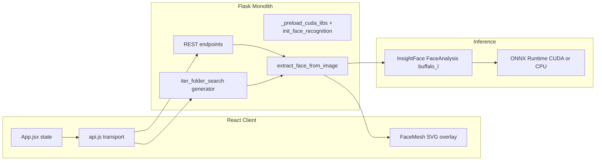
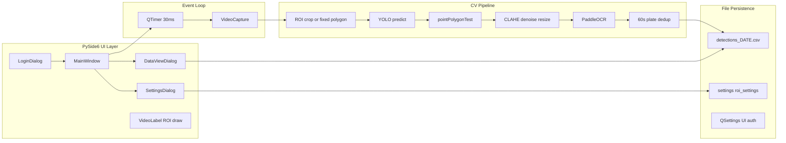
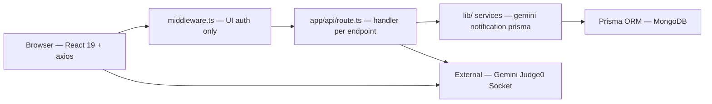
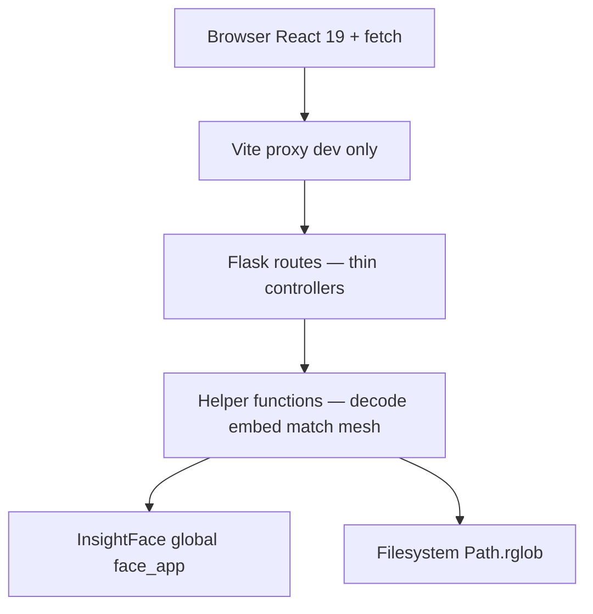

# Software Architecture

**Related:** [[Engineering Profile]] · [[Backend Engineering]] · [[AI Engineering]] · [[API Design]] · [[Performance]]

---

## Six-System Context

```mermaid
flowchart TB
    subgraph ff [Face Finder — Local Face Search]
        ReactFF[React Vite SPA]
        FlaskFF[face_finder_service.py Flask]
        Insight[InsightFace buffalo_l ONNX]
        FSFF[Local image folders]
    end

    subgraph nexus [NexusPath — AI LMS]
        NextUI[Next.js App Router React 19]
        NextAPI[app/api/* Route Handlers]
        Prisma[Prisma ORM WASM]
        MongoNP[(MongoDB)]
        Gemini[Gemini API]
        Judge0[Judge0 RapidAPI]
        Socket[Socket.IO Pages API]
    end

    subgraph iink [Iink — Document OCR]
        React1[React Dashboard]
        FastAPI1[server.py]
        Engine[iink_engine]
        Mongo1[(Mongo metadata)]
        FS1[projects/ artifacts]
        GPU1[Local GPU / vLLM]
    end

    subgraph mapims [MAPIMS — Hospital Feedback]
        React2[React SPA Vite]
        Express[index.js Express 5]
        Mongo2[(MongoDB)]
        OR[OpenRouter LLM]
    end

    subgraph vocalang [VocalAng — Voice Interview]
        FastAPI2[backup_latest.py]
        FastRTC[FastRTC Stream]
        Whisper[faster-whisper]
        Ollama[Ollama local LLM]
    end

    subgraph kvcet [KVCET ANPR — Campus Gate CV]
        PySide[real7.py PySide6]
        YOLO[Ultralytics YOLO best.pt]
        Paddle[PaddleOCR SVTR_LCNet]
        CSV[data_log CSV JSON]
        OpenCV[OpenCV VideoCapture]
    end

    ReactFF --> FlaskFF --> Insight
    FlaskFF --> FSFF
    NextUI --> NextAPI --> Prisma --> MongoNP
    NextAPI --> Gemini & Judge0
    NextUI --> Socket
    React1 --> FastAPI1 --> Engine --> Mongo1 & FS1
    React2 --> Express --> Mongo2
    Express --> OR
    FastAPI2 --> FastRTC --> Whisper & Ollama
    PySide --> OpenCV --> YOLO --> Paddle --> CSV
```



---

## Face Finder Folder Organization — WHY

| Path | Responsibility | Rationale |
|------|----------------|-----------|
| `face_finder_service.py` | Flask API + CV pipeline + SSE generator | Single deployable unit — extracted from VocalAng when UI needed |
| `frontend/` | React Vite SPA | Separate build toolchain; CV runtime stays Python |
| `frontend/src/api.js` | HTTP + SSE client + fallback | Transport logic isolated from React components |
| `frontend/src/components/` | UI panels (SearchPanel, ResultsGrid, FaceMesh) | Component-per-concern; mesh overlay decoupled |
| `frontend/vite.config.js` | Dev proxy `/api` → `:5002` | Same-origin dev without CORS config churn |
| `frontend/dist/` | Built static assets | Production can be served separately or ignored if API-only |

**Pattern:** **Two-process local product** — Python inference server + JavaScript UI. Not embedded in VocalAng monolith because face search is a distinct user workflow with its own UX (folder path input, threshold slider, live match grid).



**Why not merge frontend into Flask templates:** Engineer already invested in React component model (from NexusPath/MAPIMS stack); Vite HMR beats Jinja iteration for interactive scan UX.

**Why extract from VocalAng:** Face search doesn't need WebRTC, Whisper, or Ollama — different dependency footprint (`insightface`, `onnxruntime-gpu`) and port (`5002`). Extraction prevents VocalAng deploy from loading ArcFace when unused.

**Import order constraint:** `_preload_cuda_libs()` runs at module load **before** `import insightface` — architecture encodes CUDA library discovery as bootstrap concern, not runtime config.

---

## KVCET ANPR Folder Organization — WHY

| Path | Responsibility | Rationale |
|------|----------------|-----------|
| `real7.py` | Entire desktop app (~2910 lines) | Versioned prototype (`real7` = 7th iteration); fastest path to working ANPR at gate |
| `model/best.pt` | Custom YOLO weights | Fine-tuned plate detector — not generic COCO; domain-specific asset outside repo |
| `data_log/` | Runtime persistence | CSV logs + JSON settings co-located; operator can backup/copy folder |
| `data_log/detections_*.csv` | Daily append-only audit | One file per day — no DB server at gate PC |
| `data_log/settings.json` | Confidence thresholds | Runtime tunable without recompile |
| `data_log/roi_settings.json` | Normalized polygon ROI | Survives window resize — fractional coordinates |
| `requirements.txt` | Pinned CV stack | Reproducible torch/ultralytics/paddleocr versions |
| `.venv/` | Windows venv (committed path) | Local dev environment — not containerized |

**Pattern:** **Edge desktop monolith** — all inference, UI, and logging in one process on operator workstation. No server, no network API, no cloud dependency.



**Why single file:** Gate deployment is one Windows PC with GPU — no microservice benefit. Class-per-dialog structure (`VideoLabel`, `SettingsDialog`, `DataViewDialog`, `LoginDialog`, `MainWindow`) provides logical separation without file split overhead.

**Coordinate space problem solved:** Three coordinate systems bridged explicitly:
1. **Widget space** — `VideoLabel.roi_points` in QLabel pixels (user draws here)
2. **Normalized space** — `roi_settings.json` stores `x/width`, `y/height` (persistence)
3. **Frame space** — `scale_x = frame_width / label_width` maps ROI to OpenCV frame for YOLO

---

## NexusPath Folder Organization — WHY

| Path | Responsibility | Rationale |
|------|----------------|-----------|
| `app/admin/*` | Admin portal pages | Role boundary = folder boundary; layout.tsx shared chrome |
| `app/faculty/*` | Faculty portal | Course/workshop/roadmap management isolated from student UX |
| `app/student/*` | Student portal | Largest surface — quiz, code test, career, certificates |
| `app/lms/*` | LMS sub-portal | Secondary navigation layer for learning features |
| `app/api/*` | ~100 REST route handlers | **One file per endpoint** — Next.js convention; grep-friendly; no shared router file |
| `lib/gemini-ai.ts` | LLM service + queue + cache | Extracted when rate limits hit — single place for 429 handling |
| `lib/notification-service.ts` | Notification domain logic | Extracted — reused by cron + individual API routes |
| `lib/prisma.ts` | Singleton Prisma client | Correct pattern — but many routes still `new PrismaClient()` |
| `lib/auth.ts`, `lib/jwt.ts` | Auth utilities | Thin layer; faculty record auto-provisioning |
| `middleware.ts` | UI route guards | **Excludes `/api`** — API auth is per-handler |
| `pages/api/socket.ts` | Socket.IO server | Legacy Pages router — real-time not migrated to App Router |
| `hooks/useAIGeneration.ts` | AI UX state machine | Frontend error taxonomy for quota/rate/timeout |
| `components/realtime/*` | Messaging UI | Separated when Socket.IO integration grew |
| `scripts/*` | Seed, debug, admin creation | Operational scripts outside app bundle |
| `prisma/schema.prisma` | 30+ models | Single schema file — domain co-evolves |
| `task.md` | 48-task build log | Process artifact — sequential AI-assisted development |

**Pattern:** **Vertical slice by role** (admin/faculty/student) over horizontal layers. Backend logic lives **inside route files** until extraction pressure forces `lib/` modules.

---

## NexusPath Layered Architecture



**Not cleanly layered** — business logic, validation, and Prisma queries coexist in route handlers. Acceptable for prototype velocity; extraction targets: `services/quiz.ts`, `services/roadmap.ts`, `middleware/api-auth.ts`.

**Hybrid router:** App Router (primary) + Pages Router (`socket.ts` only) — common Next.js migration halfway state.

---

## VocalAng Folder Organization — WHY

| Path | Responsibility | Rationale |
|------|----------------|-----------|
| `backup_latest.py` | Entire backend + AI + WebRTC | Single-file iteration; fastest path to working voice loop |
| `face_finder/` | Original Flask + InsightFace microservice | **Promoted to standalone `/Freelance/face_finder` repo** |
| `models/` | Local ONNX + Whisper weights | Offline deploy |

**Pattern:** Keep the **real-time audio hot path** in one Python process. Extract when stack diverges — Face Finder is the completed extraction.

---

## Face Finder Layered Architecture



**Not layered in enterprise sense** — routes call helpers directly; no service/repository split. Acceptable for 714-line scope. Extraction candidates: `cuda_bootstrap.py`, `face_matcher.py`, `sse_search.py` if second consumer appears.

**Global mutable state:** `face_app`, `execution_provider` globals — single-process assumption; no worker pool.

---

## MAPIMS Folder Organization — WHY

| Path | Responsibility | Rationale |
|------|----------------|-----------|
| `backend/src/index.js` | All HTTP routes | Single deployable unit |
| `frontend/src/app/lib/` | Domain logic without React | Testable; cache survives component unmount |

**Pattern:** Extract lib modules when the same query/cache logic serves multiple pages.

---

## Iink Folder Organization — WHY

| Path | Responsibility | Rationale |
|------|----------------|-----------|
| `iink_engine/` | OCR, layout, export | Importable package shared by Flask + FastAPI |
| `projects/` | Per-project artifacts | Large binaries off Mongo |

---

## Design Patterns — All Projects

| Pattern | Face Finder | NexusPath | Iink | MAPIMS | VocalAng | KVCET ANPR | Why |
|---------|-------------|-----------|------|--------|----------|------------|-----|
| **Facade** | `face_app.get()` wrapper funcs | `GeminiAIService` | `ocr_runtime` | `fetchFeedbackList` | `phi3_chat` | `process_frame` + `process_plate_image` | Hide model complexity |
| **State machine** | Scan session in React state | Quiz attempt limits, cert status | `workflow_status` | ticket `status` | `InterviewState` | Detection dedup window | Ops lifecycle |
| **Strategy** | SSE stream vs REST fallback | Rule suggestions vs Gemini | Matcher strategies | Heuristic → OpenRouter | Rule vs LLM validation | ROI polygon vs fixed_area fallback | Fast path before slow |
| **Cache-aside** | N/A — re-embed each scan | Roadmap response cache 24h | `page_N.json` | `feedbackCache` | Whisper models dir | N/A — live video | Avoid repeat expensive work |
| **Fail-forward** | REST fallback on SSE fail | Fallback quiz/roadmap | JSON salvage | Incremental sync | Hallucination filter | Empty OCR → skip log | Never corrupt audit trail |
| **Lite API** | N/A | `courses-simple` | N/A | `lite=1` | N/A | N/A | List view payload discipline |
| **Generator/SSE** | `iter_folder_search` yields | N/A | SSE status poll | Deferred worker | EventSource | N/A | Long job progress |
| **Service class** | N/A | `NotificationService` | N/A | N/A | N/A | N/A | Domain logic reuse |
| **God file / many routes** | `face_finder_service.py` | 100+ route files | `server.py` | `index.js` | `backup_latest.py` | `real7.py` | Speed over structure early |
| **Two-stage CV** | Detect face → embed → compare | N/A | VL layout | N/A | Face detect | YOLO → OCR crop | Detect then match |
| **Spatial gate** | N/A | N/A | Page regions | N/A | N/A | pointPolygonTest + ROI bbox | Reduce false positives |
| **Daily file rotation** | N/A | N/A | N/A | N/A | N/A | `detections_YYYY-MM-DD.csv` | Simple audit without DB |

---

## Configuration Management — NexusPath

**Environment-driven:**

```
DATABASE_URL          → MongoDB via Prisma
JWT_SECRET            → Token signing (defaults to 'supersecret' — debt)
llm_api_key           → Gemini API key
llm_api_url           → Gemini endpoint URL
llm_model             → Model identifier
CRON_SECRET           → Notification scheduler auth
NODE_ENV              → Cookie secure flag
```

**In-code constants (debt):**
- Judge0 RapidAPI key hardcoded in `code-execution/route.ts`
- `GeminiAIService` queue: 6s min delay, 20 requests/day

**Runtime tunable:**
- Gemini `generationConfig` per method (temperature, maxOutputTokens)
- axios `timeout`: 30s default, 120s `aiApi`

---

## Separation of Concerns — NexusPath

**Strengths:**
- `GeminiAIService` isolates all LLM HTTP, retry, parse, fallback
- `NotificationService` isolates notification creation + bulk operations
- Role-based folder structure mirrors product org chart
- `useAIGeneration` hook centralizes frontend AI error handling
- Extensive documentation decoupled from code (`TECHNICAL_DOCUMENTATION.md`)

**Tensions:**
- ~40+ routes instantiate `new PrismaClient()` instead of singleton — connection pool risk
- Duplicate Gemini fetch logic in `daily-quiz-generate/route.ts` vs `lib/gemini-ai.ts`
- `generate-roadmap-suggestions` uses rule-based logic but lives under `/api/ai/` — naming mismatch
- Socket.IO in Pages router while REST in App router — two server patterns
- Middleware protects UI but not API — security boundary split
- `User.plainPassword` field — anti-pattern stored alongside bcrypt hash

---

## Dependency Management — NexusPath

| Layer | Choices | Why |
|-------|---------|-----|
| Framework | Next.js 16 + React 19 | Full-stack TypeScript; App Router |
| ORM | Prisma 6 + MongoDB | Schema-first; WASM engine for edge compatibility |
| Auth | jsonwebtoken + bcrypt | Simple JWT; no NextAuth complexity |
| UI | Radix + Tailwind + ShadCN | Accessible components; rapid UI |
| Charts | Recharts | Analytics dashboards |
| Editor | Monaco | Code test IDE |
| Real-time | Socket.IO 4 | Mature; separate from App Router |
| HTTP client | axios | Interceptors for token injection |

**Notable:** Both `bcrypt` and `bcryptjs` in package.json — redundant dependency.

---

## Scalability Architecture — NexusPath (Current)

- **Vertical:** Single Next.js process; Prisma connection per hot route handler
- **MongoDB:** Document model fits LMS entities; JSON strings for AI content avoid schema migrations
- **Gemini bottleneck:** RequestQueueManager serializes to 10 req/min; 20/day cap — free tier awareness
- **Judge0:** External execution — scales with RapidAPI quota, not local CPU
- **Socket.IO:** In-memory `connectedUsers` Map — single instance only
- **No job queue:** Cron route runs synchronously; no Bull/Redis

See [[Performance]] and [[Weaknesses]].

---

## Why These Decisions Exist

| Decision | Reason |
|----------|--------|
| MongoDB not PostgreSQL | Flexible schema for AI JSON blobs; Prisma Mongo support; task.md evolved |
| File-per-route API | Next.js App Router convention; easy Cursor AI task targeting |
| JSON strings in DB | Quiz questions, milestones change shape with prompts — avoid migration per tweak |
| Certificate PDF in Mongo Bytes | Simplicity over S3; works for prototype scale |
| Dual User + Student/Faculty models | Auth identity vs domain profile separation |
| TASKS.md sequential build | AI co-pilot works best one file/task at a time |
| Middleware excludes API | Faster API iteration during build; per-route auth added incrementally |
| KVCET: no module split | Gate prototype velocity; class-per-dialog is sufficient internal structure |
| KVCET: hardcoded fixed_area | Camera mount reference polygon when operator hasn't calibrated ROI yet |
| Face Finder: no requirements.txt in repo | Dependency versions implicit — reproducibility gap |
| Face Finder: global face_app | Single model instance — correct for one worker; blocks multi-process |
| Face Finder: duplicate search logic | `search-in-folder`, `search-complete`, `iter_folder_search` share core loop | DRY debt acceptable at current size |
