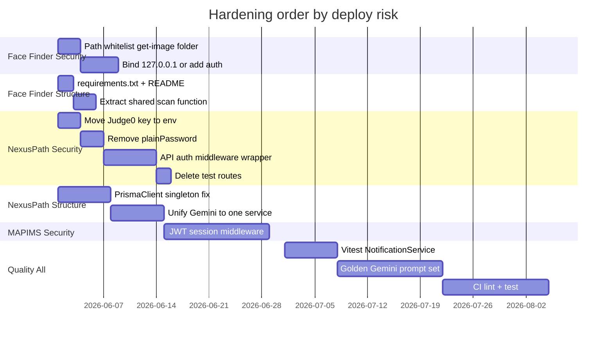

# Weaknesses & Technical Debt

**Related:** [[Security]] · [[Skill Matrix]] · [[Learning Roadmap]] · [[Engineering Profile]]

---

## Architecture Limitations

### Face Finder
| Issue | Impact |
|-------|--------|
| Monolithic `face_finder_service.py` ~714 lines | Hard to test; duplicate search logic across 3 endpoints |
| No `requirements.txt` | Reproducible deploy gap |
| Path traversal on `/get-image` | **Critical** if networked |
| Unrestricted `folder_path` | Reads any server directory |
| `host='0.0.0.0'` | Exposes service on all interfaces |
| No server-side image size limit | Base64 bomb potential |
| Sequential scan only | 10k+ images = minutes with no parallelism |
| No embedding cache | Rescanning same folder recomputes all embeddings |
| Flask dev server in production | Not production-grade WSGI |
| CORS wide open | Cross-origin abuse if networked |
| `include_subfolders` param documented but unused | API doc drift |

---

### NexusPath
| Issue | Impact |
|-------|--------|
| ~100 route files with inline logic | Duplication; hard to enforce auth consistently |
| Hybrid App + Pages router | Socket.IO stuck on legacy pattern |
| Dual messaging paths (Socket + REST) | Message model not wired to Socket handler |
| Dual Gemini integration paths | Inline fetch vs GeminiAIService drift |
| No API middleware layer | Security relies on per-route discipline |
| MongoDB with 30+ models in one schema file | Merge conflict risk; slow schema comprehension |
| Synchronous cron in HTTP request | Timeout risk at scale |
| No pagination on list endpoints | Memory + payload growth |

### VocalAng
| Issue | Impact |
|-------|--------|
| Monolithic `backup_latest.py` ~3467 lines | Hard to test, navigate |
| In-memory session state | Lost on restart |
| No auth layer | Cannot deploy untrusted |

### MAPIMS
| Issue | Impact |
|-------|--------|
| No backend auth middleware | API callable without login |
| Monolithic `index.js` ~2625 lines | God file |

### Iink
| Issue | Impact |
|-------|--------|
| Monolithic `server.py` | Hard to test |
| Dual Flask + FastAPI | Security drift |

### KVCET ANPR
| Issue | Impact |
|-------|--------|
| Monolithic `real7.py` ~2910 lines | Hard to test, navigate |
| Inference on UI thread | Frame stutter during OCR |
| No plate format validation | OCR garbage enters CSV |
| `device=0` hardcoded vs `self.device` | CPU fallback broken for infer |
| GPU required for webcam despite CPU init | Operator blocked on CPU-only PC |
| Duplicate export logic in DataViewDialog | Maintenance burden |
| Hardcoded `fixed_area` coords | Breaks if camera resolution changes |
| `model/best.pt` not versioned in repo | Reproducibility gap |

---

## Code Smells — NexusPath

| Smell | Location | Fix |
|-------|----------|-----|
| `new PrismaClient()` in routes | 40+ route files | Import singleton from `lib/prisma.ts` |
| Hardcoded API key | `code-execution/route.ts` | `process.env.JUDGE0_API_KEY` |
| Default JWT secret | `lib/jwt.ts` | Fail startup if unset |
| `plainPassword` on User | `schema.prisma` | Remove; use secure provisioning flow |
| Auth commented out | `generate-roadmap-suggestions/route.ts` | Re-enable verifyToken |
| Test routes in prod | `/api/test-*` | Gate with env or delete |
| Misnamed AI endpoint | `generate-roadmap-suggestions` uses rules not LLM | Rename or add Gemini |
| Duplicate bcrypt deps | `package.json` bcrypt + bcryptjs | Pick one |
| Type mismatch | `MessageRoomMember.userId Int` | Change to ObjectId String |
| Heavy console.log | All routes + api.ts | Structured logger |
| `any` types | Quiz generation, hooks | Proper interfaces |

---

## Code Smells — Face Finder

| Smell | Location | Fix |
|-------|----------|-----|
| Duplicate search loop | `search_in_folder`, `search_complete`, `iter_folder_search` | Extract `_scan_folder(ref, path, threshold)` |
| Global mutable state | `face_app`, `execution_provider` | App factory or dependency injection |
| Path injection | `get_image()`, `folder_path` | `safe_resolve()` with allowed roots |
| Missing mesh in lite endpoint | `/search-in-folder` | Add optional `include_mesh` param |
| Hardcoded production URL | `api.js` `http://localhost:5002` | Env `VITE_API_BASE` |
| No requirements.txt | repo root | Pin insightface, flask, onnxruntime-gpu |
| print() logging | throughout | structlog or Python logging module |

---

## Code Smells — VocalAng / MAPIMS (Retained)

God files, backup proliferation, lock race in response(), MAPIMS client+server HOD filter duplication.

---

## Code Smells — KVCET ANPR

| Smell | Location | Fix |
|-------|----------|-----|
| God file | `real7.py` entire app | Split `cv_pipeline.py`, `ui/`, `storage.py` |
| Hardcoded credentials | `LoginDialog.try_login()` | bcrypt + SQLite or OS auth |
| `device=0` hardcoded | `process_frame` model calls | Use `self.device` consistently |
| GPU gate mismatch | CPU init OK but webcam blocked | Unify `gpu_ready` policy |
| Duplicate date-filter logic | `export_all_csv` + `export_all_as_zip` | Extract `_files_for_filter(mode)` |
| Misnamed export button | "Export to Excel" uses xlsx | Rename or add true CSV export |
| UI thread inference | QTimer → YOLO + OCR | `QThread` worker + signal |
| Magic numbers | `fixed_area`, `detection_interval=60` | Move to settings.json |
| No Indian plate regex | OCR accepts any string | Optional validation with override |

---

## Missing Best Practices — All Projects

| Gap | Face Finder | NexusPath | Iink | MAPIMS | VocalAng | KVCET ANPR |
|-----|-------------|-----------|------|--------|----------|------------|
| Automated tests | None | None | None | None | verify_stt.py only | None |
| Request validation library | No Pydantic | No Zod | Partial Pydantic | No Zod | No Pydantic | No Pydantic |
| API auth middleware | **None** | Partial per-route | Partial | **Critical gap** | None | N/A |
| Path sanitization | **Critical gap** | N/A | N/A | N/A | Report path risk | N/A |
| requirements.txt / lockfile | **Missing** | package-lock | requirements.txt | package-lock | requirements | requirements.txt |
| CI pipeline | None | None | None | None | None |
| OpenAPI spec | None | None | None | None | N/A |
| Structured logging | console.log | traceback | console tags | DEBUG prints | print + QMessageBox |
| Pagination | Missing | N/A | Missing | N/A | N/A |
| Rate limiting | Gemini queue only | N/A | N/A | N/A | Dedup only |

---

## Security Gaps — Prioritized

**Face Finder (if networked):**
1. Path traversal on `/get-image?path=`
2. Unrestricted `folder_path` directory read
3. No authentication on any endpoint
4. Binds `0.0.0.0` by default

**NexusPath (production critical):**
1. Hardcoded Judge0 RapidAPI key in source
2. `User.plainPassword` reversible credential storage
3. JWT_SECRET defaults to `'supersecret'`
4. `/api` excluded from middleware — inconsistent route auth
5. Open test endpoints (`test-db`, `test-gemini`)
6. Auth disabled on `generate-roadmap-suggestions`
7. No login rate limiting

**MAPIMS (production critical):**
1. No API authentication
2. Open repair/seed endpoints

**VocalAng (if cloud-deployed):**
1. No authentication
2. Report path traversal risk

**KVCET ANPR (if shared workstation):**
1. Hardcoded admin/admin credentials
2. CSV plate data readable on disk without encryption
3. No audit trail for export/delete actions

---

## Scalability Risks — NexusPath

1. PrismaClient per route — connection pool exhaustion under concurrent requests
2. Gemini 20/day cap — breaks daily quiz for >20 students without cache hit
3. In-memory roadmap cache — lost on serverless cold start; not shared across instances
4. Certificate PDF in Mongo — 16MB document limit; memory pressure
5. Cron notification O(n) students in single HTTP request
6. Socket.IO in-memory Map — cannot horizontal scale without Redis adapter
7. Full list endpoints — no cursor pagination

---

## ML / Quality Gaps — NexusPath

- No prompt regression for quiz/roadmap generation
- No validation that Gemini JSON matches expected schema beyond parse
- No monitoring of fallback content rate (signal of AI degradation)
- Rule-based suggestions endpoint mislabeled as AI — product honesty gap
- No A/B testing of prompt variants

---

## Documentation Gaps — NexusPath

- `task.md` says PostgreSQL; schema is MongoDB — stale reference
- TECHNICAL_DOCUMENTATION.md may drift from 100+ routes
- No ADR folder (this vault compensates)
- Which routes require auth — undocumented matrix

---

## Debt Already Being Paid Down

**NexusPath:** GeminiAIService extraction, NotificationService extraction, lite API routes, useAIGeneration error hook, cron idempotency, RateLimitError types.

**MAPIMS:** lite API, sinceMs, feedbackCache, HOD server filter.

**VocalAng:** concurrency locks, hallucination filters, model hot-swap.

**KVCET ANPR:** ROI normalization, dual confidence UI, daily CSV rotation, preprocessing chain, GPU/CPU split.

**Face Finder:** CUDA ctypes preload, SSE streaming, React UI extraction, client SSE fallback, landmark mesh overlay.

---

## Actionable 90-Day Improvements — Unified

See [[Learning Roadmap]].
